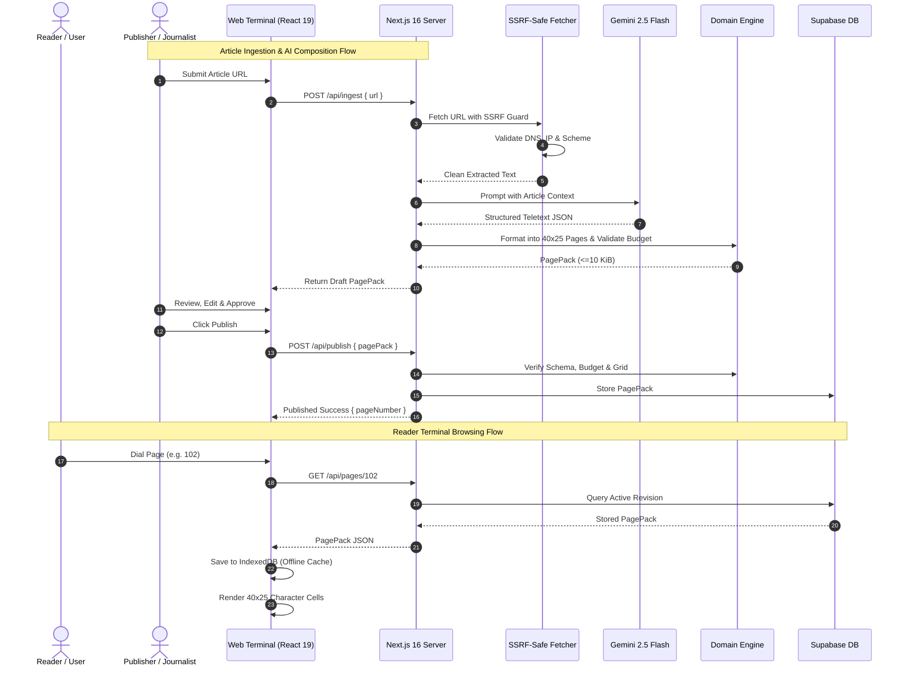
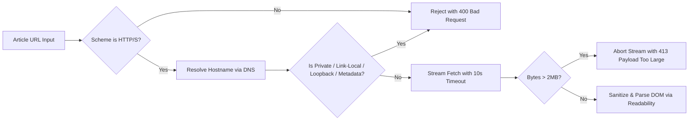

# PageCast Specification: 01 Product Foundation — Design

**Document:** Product Foundation Technical Design  
**Spec ID:** `SPEC-01-DES`  
**Traceability Source:** `docs/ARCHITECTURE.md` & `docs/TECHNICAL_DECISIONS.md`  
**Status:** Approved  

---

## 1. System Architecture & Component Interaction

PageCast separates concerns into four distinct layers: Presentation, Pure Domain Engines, Application Services, and External Infrastructure.



---

## 2. Core Data Models & Schemas

### 2.1 Character Span, Row & Page (`src/domain/teletext/types.ts`)
```typescript
export type TeletextColor =
  | 'black'
  | 'white'
  | 'red'
  | 'green'
  | 'yellow'
  | 'blue'
  | 'magenta'
  | 'cyan';

export interface TeletextSpan {
  readonly text: string;
  readonly color?: TeletextColor;
  readonly doubleHeight?: boolean;
}

export interface TeletextRow {
  readonly spans: readonly TeletextSpan[];
}

export interface FastextLinks {
  readonly red: number; // 100 - 899
  readonly green: number; // 100 - 899
  readonly yellow: number; // 100 - 899
  readonly cyan: number; // 100 - 899
}

export interface TeletextPage {
  readonly pageNumber: number; // 100 - 899
  readonly subPageNumber?: number; // 1 - 99
  readonly subPageCount?: number;
  readonly title: string;
  readonly rows: readonly TeletextRow[]; // exactly 25 rows
  readonly fastext: FastextLinks;
}
```

### 2.2 Canonical PagePack Schema (`src/domain/page-pack/types.ts`)
```typescript
export interface PagePackMetadata {
  readonly originalUrl?: string;
  readonly sourceName: string;
  readonly author?: string;
  readonly language: 'en' | 'hi';
  readonly aiAssisted: boolean;
  readonly promptVersion?: string;
  readonly modelId?: string;
  readonly publisherId: string;
}

export interface PagePack {
  readonly id: string; // UUID v4
  readonly version: 1; // Schema version
  readonly slug: string; // URL-safe slug
  readonly title: string;
  readonly magazine: number; // 1 - 8
  readonly primaryPageNumber: number; // 100 - 899
  readonly createdAt: string; // ISO 8601
  readonly metadata: PagePackMetadata;
  readonly pages: readonly TeletextPage[];
}
```

---

## 3. Layout Engine Rules & Invariants

1. **Grid Invariants:**
   - A page canvas has exactly **25 rows** (index 0 to 24).
   - Each row has a capacity of exactly **40 visual character cells**.
   - Row 1 (index 0) is the broadcast header: `P[Page]  PAGECAST  [Day] [Date]  [HH:MM:SS]`.
   - Rows 2–24 (indices 1–23) are the 23 usable content rows.
   - Row 25 (index 24) is the navigation bar with 4 Fastext shortcut indicators or source links.
2. **Text Wrapping:**
   - Pure algorithmic word-wrapping breaks on whitespace; words longer than 40 columns are hyphenated safely.
   - Devanagari and combining Unicode sequences are kept intact without splitting combining marks or diacritics.
3. **Byte Budget Calculation:**
   - Serialized UTF-8 bytes are computed via `new TextEncoder().encode(JSON.stringify(pagePack)).length`.
   - `PAGECAST_MAX_PACK_BYTES` is strictly 10,240 bytes (10 KiB). Any pack exceeding this value is rejected by domain validators.

---

## 4. Security Architecture & SSRF Defenses



- **SSRF Defenses:**
  - Whitelist: Only standard public domain names resolving to globally routable IPv4/IPv6 addresses.
  - Blacklist: Loopback (`127.0.0.0/8`, `::1`), RFC 1918, Link-Local (`169.254.0.0/16`), Cloud metadata endpoints (`169.254.169.254`).
  - Max Redirects: 3, validating destination IP at every hop.
  - Size Limit: 2 MB maximum.
  - Timeout: 10,000 ms.
- **Client Security:**
  - Zero sensitive server secrets in browser bundles (`check-env-safety.mjs` verification).
  - CSP Headers: `default-src 'self'`.
  - DOM injection defense: No unsanitized `dangerouslySetInnerHTML`.
