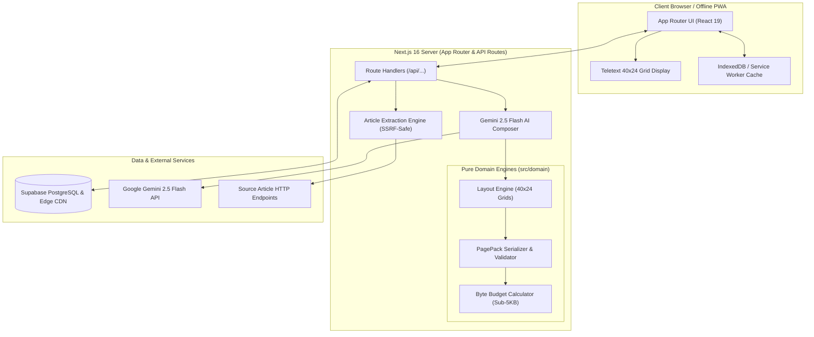

# PageCast — Architecture Steering Guide

## 1. System Architecture Overview

PageCast employs a clean, layered architecture separating pure domain logic from framework presentation, cloud infrastructure, and external AI providers.

---

## 2. Layer Definitions & Responsibilities

### 2.1 Presentation Layer (`src/app/`, `src/components/`)
- Built with **Next.js 16 App Router** and **React 19**.
- Uses Server Components by default for fast initial render and minimal client bundle size.
- Client Components (`"use client"`) are strictly reserved for stateful user interaction:
  - CRT screen rendering and CRT effect controls (scanlines, curvature, phosphor glow).
  - Keyboard listener for numeric dialing (0–9) and Fastext navigation (F1–F4 or Red/Green/Yellow/Cyan buttons).
  - Page pack interactive editor in the Publisher Studio.

### 2.2 Domain Layer (`src/domain/`)
- Contains **pure, deterministic TypeScript functions** with zero framework or browser dependencies.
- **`layout-engine/`**: Splits article text into 40-column wrapped lines, manages Teletext header rows (Row 0: Page Number, Day, Date, Time), page breaks, and mosaic art.
- **`page-pack/`**: Defines Page Pack data models, schemas (Zod), serialization, deserialization, and integrity validation.
- **`byte-budget/`**: Calculates UTF-8 byte weights of characters, strings, and serialized page packs, strictly enforcing the 5,120-byte maximum limit.

### 2.3 Application & Services Layer (`src/services/`)
- **`article-fetcher/`**: Retrieves external HTML content with hardened SSRF protection, parses text with Readability-style heuristics, and extracts headline, author, and paragraphs.
- **`ai-composer/`**: Formulates structured prompt envelopes for Google Gemini 2.5 Flash with few-shot teletext examples, parsing the returned structured JSON into raw 40×24 pages.
- **`storage/`**: Interfaces with Supabase PostgreSQL to store and query bulletins by magazine number and slug.

---

## 3. Hard Architectural Constraints

| Constraint | Enforcement Mechanism |
| :--- | :--- |
| **Sub-5KB Pack Budget** | `PAGECAST_MAX_PACK_BYTES = 5120`. Pack serializer rejects any pack exceeding 5,120 bytes uncompressed UTF-8. Tested with property tests (100+ runs). |
| **Strict 40×24 Grid** | Teletext pages MUST have exactly 24 rows, each with at most 40 monospaced characters. Row 0 is reserved for standard Teletext broadcast headers. |
| **Server-Only Secrets** | All AI and database service keys (`GOOGLE_GENERATIVE_AI_API_KEY`, `SUPABASE_SERVICE_ROLE_KEY`) are prohibited from client code or `NEXT_PUBLIC_` prefixes. Validated via `scripts/check-env-safety.mjs`. |
| **SSRF Safe Fetching** | Article fetching rejects private IP ranges (RFC 1918, loopback, link-local, AWS/GCP metadata endpoints), limits redirects to 3, enforces 10s timeout, and caps input at 2MB. |
| **Zero Heavy UI Libs** | No Radix, no Material UI, no Chakra. Pure Tailwind CSS 4 design tokens and semantic HTML to maintain a lean bundle footprint. |
| **Offline-First Delivery** | Service Worker caches page packs on initial load. The reader terminal can operate entirely offline without network access once cached. |

