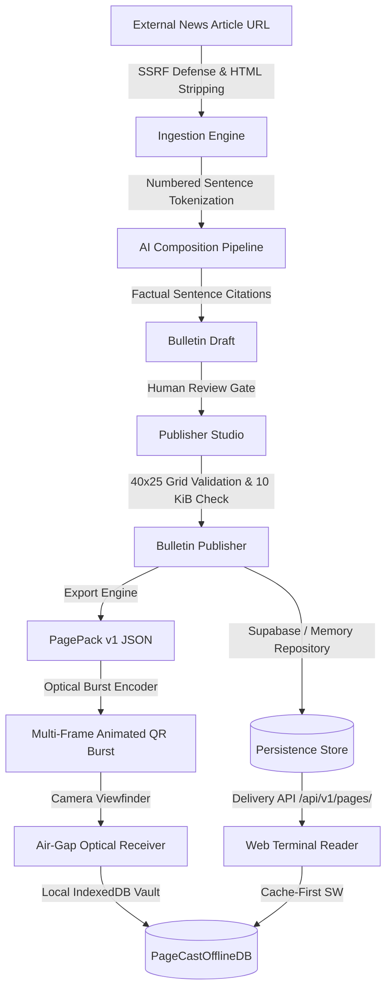

# 📺 PageCast — AI-Powered Low-Bandwidth Teletext Platform

[](#test-suite)
[](#hackathon-category)
[-black.svg)](https://nextjs.org/)
[-blue.svg)](https://www.typescriptlang.org/)
[](docs/ACCESSIBILITY_AUDIT_REPORT.md)
[](src/app/privacy/page.tsx)
[](LICENSE)

> **Resurrecting BBC Ceefax (1974) for the 2026 Emergency & Low-Bandwidth Era.**  
> Transform real-world news and crisis alerts into structured, 40×25 Teletext bulletins capped strictly at **10 KiB**, broadcastable over 2G cellular, HF radio, or animated optical QR bursts without internet connectivity.

---

## 🏆 Hackathon Category

**Kiroween 2026 — Resurrection Category**  
PageCast revives the legendary broadcast medium of 1970s Teletext (BBC Ceefax, ITV Oracle) and reinvents it as a modern, AI-assisted, offline-first resilient communications stack.

---

## ⚡ The Problem: The Modern Web Bloat Crisis

- The average web page in 2026 transfers **2.5 MB to 5.0 MB** of bloated JavaScript, trackers, and dynamic ads.
- During natural disasters, power grid collapses, or rural cellular network throttling (2G/EDGE), traditional websites completely fail to load.
- Modern automated summarizers hallucinate claims with zero accountability or traceability.

### The PageCast Solution

| Dimension | Modern Web | PageCast Teletext |
|---|---|---|
| **Payload Size** | 2,500 – 5,000 KiB | **<= 10 KiB (Strict Ceiling)** |
| **Network Dependency** | Broadband / 4G / 5G | **2G, SMS, Satellite, or Optical QR Air-Gap** |
| **Grid Geometry** | Unpredictable responsive reflow | **Deterministic 40 cols × 25 rows** |
| **Offline Capability** | Fragile or absent | **Full PWA Offline Vault (IndexedDB)** |
| **Attribution** | Unverifiable black-box summaries | **Cryptographic sentence-level provenance** |
| **Tracking & Telemetry**| 20+ ad and analytics trackers | **Zero cookies, zero trackers, zero telemetry** |

---

## 🛠 Architectural Overview



---

## 🚀 Quickstart Guide

### Prerequisites

- **Node.js**: `22.x LTS` or `24.x` (verified on Node 24.13.0)
- **Package Manager**: `pnpm` (version 10 or 11)

### 1. Installation

```bash
# Clone repository
git clone https://github.com/your-username/pagecast.git
cd pagecast

# Install dependencies with frozen lockfile
pnpm install
```

### 2. Environment Configuration

Copy the example environment template:

```bash
cp .env.example .env.local
```

| Variable | Required | Description | Default / Fallback |
|---|---|---|---|
| `NEXT_PUBLIC_SUPABASE_URL` | Optional | Supabase project URL | In-Memory fallback active |
| `NEXT_PUBLIC_SUPABASE_ANON_KEY` | Optional | Supabase anonymous public key | In-Memory fallback active |
| `SUPABASE_SERVICE_ROLE_KEY` | Optional | Supabase backend admin key | In-Memory fallback active |
| `GEMINI_API_KEY` | Optional | Google Gemini API key for AI composer | Deterministic extractive fallback active |

> **Note:** PageCast is **fully functional out-of-the-box** without external API keys. If keys are omitted, the platform automatically activates its high-performance in-memory repository and deterministic frequency-based extractive text condenser.

### 3. Running Development Server

```bash
pnpm dev
```

Open [http://localhost:3000](http://localhost:3000) in your browser:
- **Terminal Reader:** [http://localhost:3000/terminal](http://localhost:3000/terminal) or [http://localhost:3000/pages/100](http://localhost:3000/pages/100)
- **Publisher Studio:** [http://localhost:3000/publisher](http://localhost:3000/publisher)
- **Broadcast Directory:** [http://localhost:3000/catalogue](http://localhost:3000/catalogue)
- **Offline Vault:** [http://localhost:3000/saved](http://localhost:3000/saved)

---

## 🧪 Verification & Quality Suite

Run all quality checks and tests locally:

```bash
# Run complete test suite (377 tests across 59 test files)
pnpm test

# Run code style and format check
pnpm format:check

# Run ESLint 9 verification
pnpm lint

# Comprehensive pre-flight quality check
pnpm quality:check

# Production build with Turbopack
pnpm build
```

---

## 🕹 Terminal Remote Control & Keyboard Legend

The terminal is keyboard-first and operates like an authentic cathode-ray tube Teletext receiver:

| Key Command | Action |
|---|---|
| `0` – `9` | Dial 3-digit page number into buffer (e.g., `1`-`0`-`1` for P101) |
| `↑` / `PgUp` | Step to next broadcast page |
| `↓` / `PgDn` | Step to previous broadcast page |
| `→` / `←` | Step through multi-page subpage carousel frames |
| `R` | Follow **RED** Fastext shortcut |
| `G` | Follow **GREEN** Fastext shortcut |
| `Y` | Follow **YELLOW** Fastext shortcut |
| `C` / `B` | Follow **CYAN** / **BLUE** Fastext shortcut |
| `Home` | Return immediately to **Main Index (P100)** |
| `T` | Toggle between CRT Raster & Text-Only Accessible Mode |
| `M` | Toggle Teletext Audio Synthesizer (Carrier Chirp & Sound) |
| `?` / `H` | Toggle keyboard shortcuts modal legend |
| `Esc` | Clear dialing buffer / dismiss active dialogs |

---

## 📚 Curated Multilingual Demonstration Catalogue

| Page | Language | Magazine | Topic | Source Attribution |
|---|---|---|---|---|
| **P100** | Bilingual | Mag 1 | Main Index | PageCast Broadcast Network |
| **P101** | English | Mag 1 | World News: Climate Accord | Reuters Diplomatic Desk |
| **P102** | Hindi | Mag 1 | राष्ट्रीय समाचार: डिजिटल साक्षरता | Press Information Bureau (PIB) |
| **P200** | English | Mag 2 | Technology: Edge Computing | Nature Electronics |
| **P400** | English | Mag 4 | Emergency: Coastal Storm Warning | Maritime Weather Operations |
| **P401** | Hindi | Mag 4 | मौसम व आपदा: भारी वर्षा रेड अलर्ट | India Meteorological Department (IMD) |

---

## 🔒 Security Architecture (SEC-001 through SEC-013)

- **SSRF Prevention:** Private IP blocking (`127.0.0.0/8`, `10.0.0.0/8`, `172.16.0.0/12`, `192.168.0.0/16`, `169.254.169.254`, `::1`, `fc00::/7`).
- **Prompt Injection Defense:** Strict `<untrusted_source_article>` XML isolation fencing and token bounds.
- **Transport Security:** HTTP `Strict-Transport-Security: max-age=63072000; includeSubDomains; preload`.
- **Clickjacking Protection:** `X-Frame-Options: DENY` and CSP `frame-ancestors 'none'`.
- **MIME Sniffing Defense:** `X-Content-Type-Options: nosniff`.
- **Sensor Privacy:** `Permissions-Policy: camera=(self), microphone=(), geolocation=()`.
- **Rate Limiting:** Sliding-window rate limiting protecting API routes against abuse.
- **Payload Limits:** 15 KiB mutation cap, 64 KiB validation cap.

---

## 📄 License

PageCast is licensed under the [MIT License](LICENSE).

