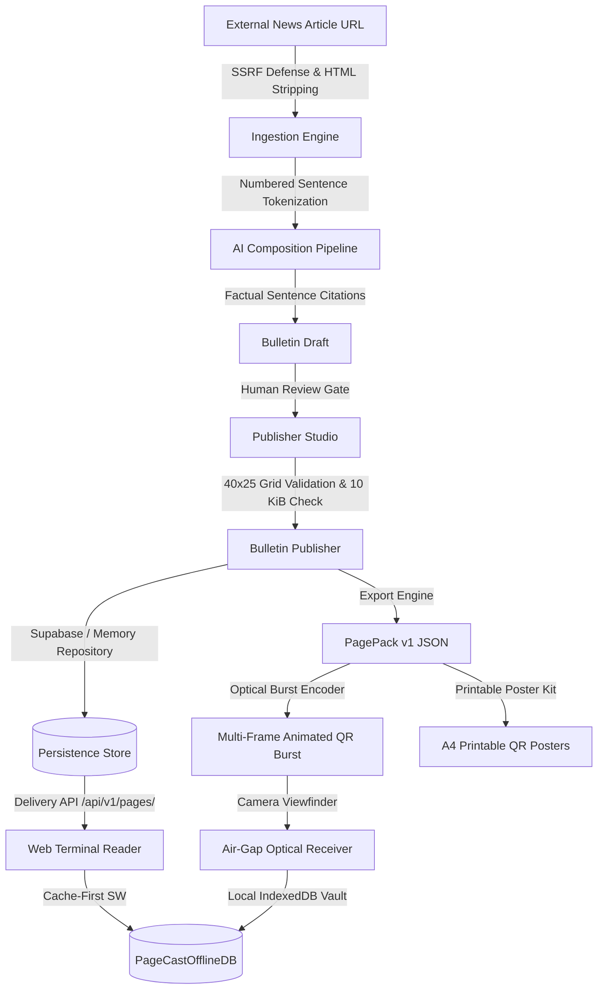

# 📺 PageCast — AI-Powered Low-Bandwidth Teletext Platform

[-brightgreen.svg)](#test-suite)
[](#hackathon-category)
[-black.svg)](https://nextjs.org/)
[-blue.svg)](https://www.typescriptlang.org/)
[](docs/PAGECAST_MCP_SERVER.md)
[](docs/ACCESSIBILITY_AUDIT_REPORT.md)
[](src/app/privacy/page.tsx)
[](LICENSE)

> **Resurrecting BBC Ceefax (1974) for the 2026 Emergency & Low-Bandwidth Era.**  
> Transform bloated web articles and crisis alerts into numbered, bilingual Teletext bulletins strictly capped at **10 KiB**, broadcastable over 2G cellular, HF radio, or animated optical QR bursts without internet connectivity.

---

## 🏆 Hackathon Category

**Kiroween 2026 — Resurrection Category**  
PageCast revives the legendary broadcast medium of 1970s Teletext (BBC Ceefax, ITV Oracle) and reinvents it as an AI-assisted, cryptographic, offline-first communications stack designed for crisis resilience, edge networks, and zero-connectivity environments.

---

## ⚡ The Modern Web Bloat Crisis vs PageCast

- The average web page in 2026 transfers **2.5 MB to 5.0 MB** of bloated JavaScript, tracking scripts, and heavy assets.
- During natural disasters, power grid failures, or rural cellular network throttling (2G/EDGE), traditional websites completely fail to load.
- Modern automated summarizers hallucinate claims with zero accountability or traceability.

| Dimension | Modern Web | PageCast Teletext |
|---|---|---|
| **Payload Size** | 2,500 – 5,000 KiB | **<= 10 KiB (Strict Payload Ceiling)** |
| **Network Dependency** | Broadband / 4G / 5G | **2G, SMS, Satellite, or Optical QR Air-Gap** |
| **Grid Geometry** | Unpredictable responsive reflow | **Deterministic 40 cols × 25 rows CRT Matrix** |
| **Offline Capability** | Fragile or absent | **Full PWA Offline Vault (IndexedDB + ServiceWorker)** |
| **Attribution** | Unverifiable black-box summaries | **Cryptographic SHA-256 sentence-level provenance** |
| **Tracking & Telemetry**| 20+ ad and analytics trackers | **Zero cookies, zero trackers, zero telemetry** |

---

## ✨ Winning Differentiators & Technical Innovations

### 1. 🔍 Source Evidence Explorer (`E`)
- Reader-facing drawer that displays the original article source, publisher review timestamps, and exact sentence citations.
- Every bullet point links directly to its source sentence with matching **SHA-256 cryptographic fingerprints**, eliminating black-box AI hallucinations.

### 2. 🧪 Data Efficiency Lab (`/lab`)
- Interactive real-world benchmark dashboard comparing standard web articles against PageCast PagePacks.
- Demonstrates **99.7% payload reduction** (from 2.8 MB to 2.4 KB) with simulated load times across 2G (GPRS/EDGE), 3G, 4G, and L-Band Satellite links.
- Backed by transparent, empirical methodology in `docs/DATA_EFFICIENCY_METHODOLOGY.md`.

### 3. 📢 Community Broadcast Kit & Printable Posters (`ENH-03`)
- Pre-defined, bilingual (English / Hindi) broadcast presets for non-journalist grassroots publishers:
  - **Academic / Campus Noticeboard** (P501)
  - **Community Health & Clinic Alert** (P601)
  - **Emergency Disaster & Weather Alert** (P101)
  - **Local Civic & Municipal Notice** (P401)
- **Printable A4 / Letter QR Poster Generator:** Scoped `@media print` layout producing high-contrast paper posters with scannable QR codes for physical community boards.

### 4. 🤖 PageCast Domain QA MCP Server (`ENH-04`)
- Built-in Model Context Protocol (MCP) server over stdio (`src/server/mcp/domain-qa-server.ts`).
- Enables **Kiro agents** and external AI models to autonomously enforce Teletext domain invariants:
  - `validate_page_grid`: Enforces 25 rows × 40 columns.
  - `measure_pagepack_bytes`: Evaluates UTF-8 bytes against the 10 KiB ceiling.
  - `verify_source_evidence`: Audits claim-to-sentence hash mappings.
  - `generate_multi_frame_qr`: Encodes PagePacks into animated QR bursts.
  - `validate_page_number`: Validates 100-899 page numbers and resolves magazine metadata.

### 5. ⚡ Low-Bandwidth Data Saver Profile (`D`)
- Unified reader-facing profile with `localStorage` persistence.
- Switches font to zero-weight system monospace stack (`ui-monospace, Menlo, Monaco, Consolas, monospace`), saving cold web font downloads.
- Disables scanlines, CRT glow, and animations to minimize GPU/CPU cycles and save mobile battery.
- Activates **cache-first resolution** and displays live session byte telemetry (`Transferred: X.X KB`).

### 6. 🕒 Bulletin Freshness & Version History (`ENH-06`)
- Revision badges (`Rev 2`) and relative freshness indicators (`Updated 2h ago`) in the terminal header.
- **Stale Local Copy Warning:** Alerts readers when an offline saved copy is older than 24 hours with a 1-click `REFRESH LIVE` button.
- **Non-Destructive Validity Expiry:** Displays an alert banner for elapsed time-sensitive emergency notices without deleting the offline archive.

---

## 🛠 Architectural Overview



---

## 🚀 Quickstart Guide

### Prerequisites
- **Node.js**: `22.x LTS` or `24.x` (verified on Node 24.13.0)
- **Package Manager**: `pnpm` (version 10 or 11)

### 1. Installation
```bash
git clone https://github.com/your-username/pagecast.git
cd pagecast
pnpm install
```

### 2. Environment Configuration
```bash
cp .env.example .env.local
```
> **Zero Configuration Required:** PageCast is **100% functional out-of-the-box** without remote credentials. It automatically runs on its deterministic extractive condensator and in-memory persistence store during local development and testing.

### 3. Running Development Server
```bash
pnpm dev
```

Open [http://localhost:3000](http://localhost:3000) in your browser:
- **Terminal Reader:** [http://localhost:3000/terminal](http://localhost:3000/terminal) or [http://localhost:3000/pages/100](http://localhost:3000/pages/100)
- **Publisher Studio:** [http://localhost:3000/publisher](http://localhost:3000/publisher)
- **Data Efficiency Lab:** [http://localhost:3000/lab](http://localhost:3000/lab)
- **Broadcast Directory:** [http://localhost:3000/catalogue](http://localhost:3000/catalogue)
- **Offline Vault:** [http://localhost:3000/saved](http://localhost:3000/saved)

---

## 🧪 Verification & Automated Quality Gate

```bash
# Run master quality gate: env check -> prettier -> eslint -> tsc -> vitest -> next build
pnpm quality:check

# Run test suite only (439 tests across 69 test files)
pnpm test:run

# Run MCP Domain QA server over stdio
npx tsx src/server/mcp/domain-qa-server.ts
```

---

## 🕹 Terminal Remote Control & Keyboard Legend

The terminal is keyboard-first and operates like an authentic Teletext receiver:

| Key Command | Action |
|---|---|
| `0` – `9` | Dial 3-digit page number into buffer (e.g., `1`-`0`-`1` for P101) |
| `↑` / `PgUp` | Step to next broadcast page |
| `↓` / `PgDn` | Step to previous broadcast page |
| `→` / `←` | Step through multi-page subpage carousel frames |
| `R` | Follow **RED** Fastext shortcut |
| `G` | Follow **GREEN** Fastext shortcut |
| `Y` | Follow **YELLOW** Fastext shortcut |
| `C` / `B` | Follow **CYAN** / **BLUE** Fastext shortcut |
| `Home` | Return immediately to **Main Index (P100)** |
| `T` | Toggle between CRT Raster & Text-Only Accessible Mode |
| `E` | Toggle **Source Evidence & Provenance Explorer** |
| `D` | Toggle **Low-Bandwidth Data Saver Mode** (System Mono Font, No Glow) |
| `M` | Toggle Teletext Audio Synthesizer (Carrier Chirp & Sound) |
| `?` / `H` | Toggle keyboard shortcuts modal legend |
| `Esc` | Clear dialing buffer / dismiss active overlays |

---

## 📚 Curated Multilingual Demonstration Catalogue

| Page | Language | Magazine | Topic | Source Attribution |
|---|---|---|---|---|
| **P100** | Bilingual | Mag 1 | Main Index | PageCast Broadcast Network |
| **P101** | English | Mag 1 | World News: Climate Accord | Reuters Diplomatic Desk |
| **P102** | Hindi | Mag 1 | राष्ट्रीय समाचार: डिजिटल साक्षरता | Press Information Bureau (PIB) |
| **P200** | English | Mag 2 | Technology: Edge Computing | Nature Electronics |
| **P400** | English | Mag 4 | Emergency: Coastal Storm Warning | Maritime Weather Operations |
| **P401** | Hindi | Mag 4 | मौसम व आपदा: भारी वर्षा रेड अलर्ट | India Meteorological Department (IMD) |
| **P501** | English | Mag 5 | Academic: End-Semester Exam Schedule | National Institute of Technology |
| **P601** | Hindi | Mag 6 | स्वास्थ्य शिविर: निःशुल्क टीकाकरण अभियान | जिला प्राथमिक स्वास्थ्य केंद्र |

---

## 🔒 Security Architecture (SEC-001 through SEC-013)

- **SSRF Prevention:** Strict private IP and loopback blocking (`127.0.0.0/8`, `10.0.0.0/8`, `172.16.0.0/12`, `192.168.0.0/16`, `169.254.169.254`, `::1`, `fc00::/7`).
- **Prompt Injection Defense:** Strict `<untrusted_source_article>` XML isolation fencing and token bounds.
- **Transport Security:** HTTP `Strict-Transport-Security: max-age=63072000; includeSubDomains; preload`.
- **Clickjacking Protection:** `X-Frame-Options: DENY` and CSP `frame-ancestors 'none'`.
- **MIME Sniffing Defense:** `X-Content-Type-Options: nosniff`.
- **Rate Limiting:** Sliding-window rate limiting protecting API routes against abuse.
- **Payload Limits:** 15 KiB mutation cap, 10,240 B PagePack ceiling, 500 KB raw source cap.

---

## 📄 License

PageCast is licensed under the [MIT License](LICENSE).
