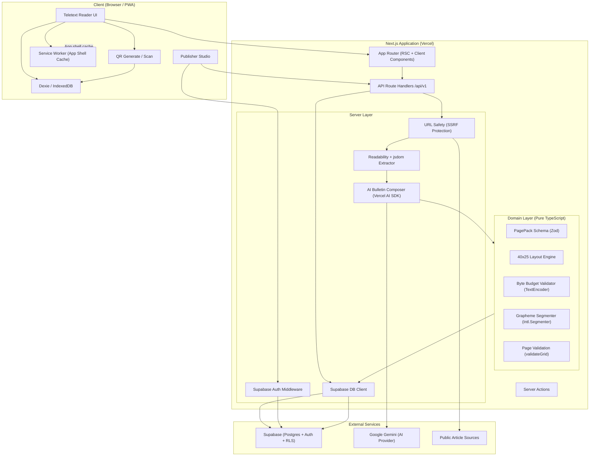
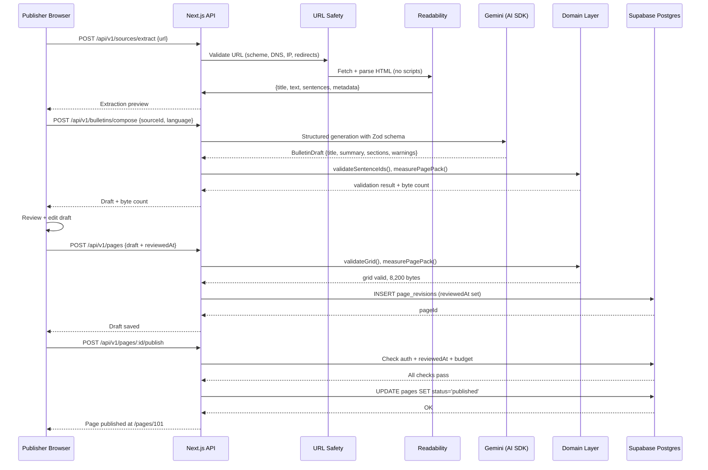
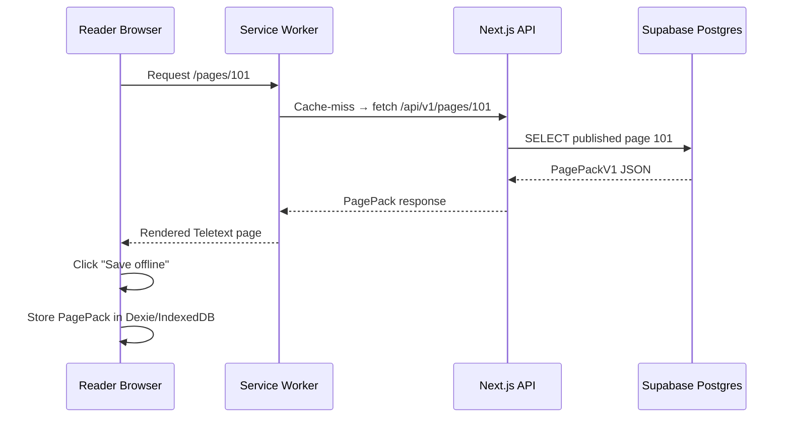
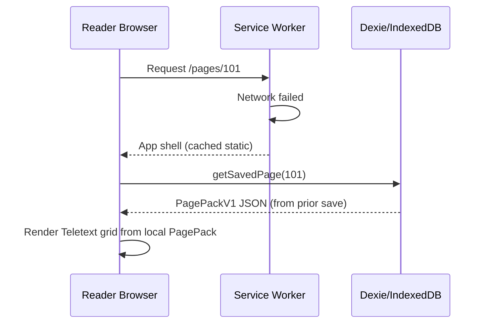
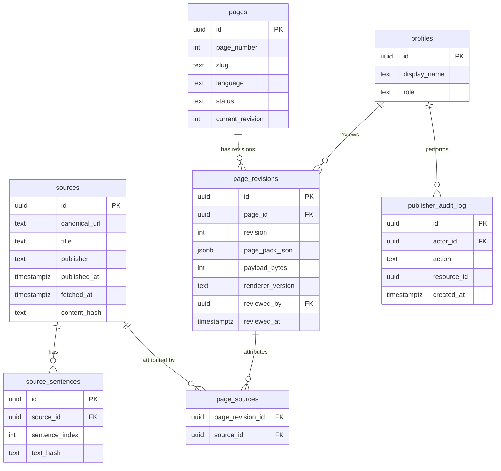
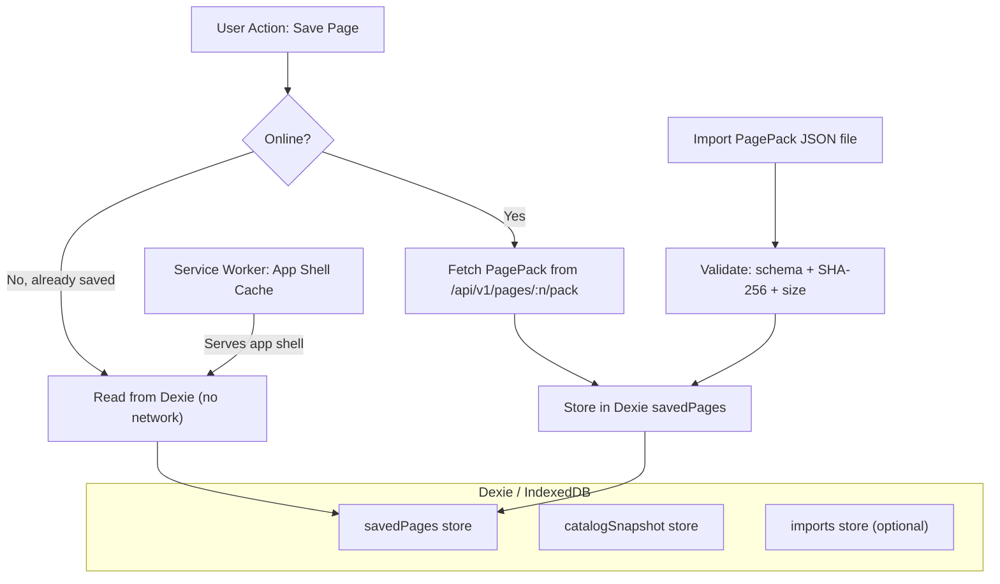
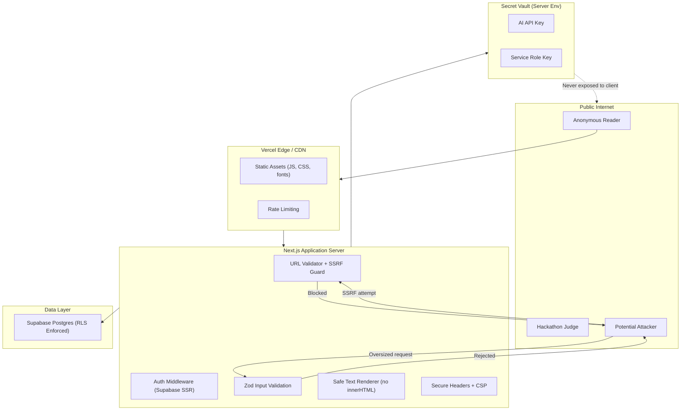

# PageCast — System Architecture

**Phase:** 1 — Discovery & Requirement Analysis  
**Date:** 30 October 2026  
**Source:** `01_pagecast_project_spec_kiroween_2026.md` §§7–16

---

## 1. Architectural Principles

The PageCast architecture is governed by seven principles from the specification:

1. **Domain logic first** — Grid renderer, PagePack schema, byte counter and validators must work without React, Next.js, Supabase or the AI SDK.
2. **Server-only secrets** — AI provider keys and Supabase service-role key never enter client code or `NEXT_PUBLIC_` variables.
3. **Human-in-the-loop publishing** — AI composes; publisher reviews; server validates; then and only then is the page public.
4. **Offline reading is local-first** — Saved PagePacks are read from IndexedDB. Network is not required for their display.
5. **Source provenance is mandatory** — Every generated page must retain a source record; no orphaned AI-generated content.
6. **Progressive enhancement** — Link QR works online; multi-frame QR is a P1 enhancement for offline transfer.
7. **No microservices** — One Next.js deployment and one Supabase project are sufficient for the hackathon.

---

## 2. High-Level Architecture Diagram

---

## 3. Component Responsibilities

### 3.1 Domain Layer (`src/domain/`) — Pure TypeScript

> [!IMPORTANT]
> This layer must import **zero** React, Next.js, Supabase or AI SDK modules. All its logic must be unit and property testable in plain Node.js.

| Component | File Path | Responsibility |
|---|---|---|
| PagePack Schema | `domain/page-pack/schema.ts` | TypeScript types and Zod schema for `PagePackV1`; schema versioning |
| Layout Engine | `domain/layout-engine/layout.ts` | Convert structured bulletin into 40×25 logical grid; word-boundary wrapping |
| Grapheme Segmenter | `domain/layout-engine/graphemes.ts` | `segmentGraphemes()` using `Intl.Segmenter`; Hindi grapheme-safe cell placement |
| Byte Budget | `domain/byte-budget/measure.ts` | `measurePagePack()` — canonical JSON serialization + `TextEncoder` byte count |
| Page Validator | `domain/validation/validate-grid.ts` | `validateGrid()` — 25 rows × 40 columns assertion; reject malformed layouts |
| Source Provenance | `domain/source-provenance/` | Source record types, attribution label construction |
| Page Number | `domain/validation/page-number.ts` | Validate 100–899 range; uniqueness rules |

### 3.2 Server Layer (`src/server/`) — Next.js Server Only

| Component | File Path | Responsibility |
|---|---|---|
| URL Safety | `server/security/url-safety.ts` | SSRF protection: scheme check, DNS resolution, IP block list, redirect chasing, timeout, size limit |
| Article Extractor | `server/ingestion/extractor.ts` | Mozilla Readability + jsdom (scripts disabled); sentence ID generation |
| AI Composer | `server/ai/composer.ts` | Vercel AI SDK wrapper; structured generation with Zod; source sentence ID validation |
| AI Fallback | `server/ai/extractive-fallback.ts` | Deterministic extractive summarizer when AI provider unavailable |
| Auth Middleware | `server/auth/middleware.ts` | Supabase SSR cookie-based session verification; role checks |
| Database Client | `server/database/client.ts` | Supabase Postgres client; typed queries; RLS-aware |

### 3.3 API Routes (`src/app/api/v1/`) — Next.js Route Handlers

| Route | Method | Auth | Responsibility |
|---|---|---|---|
| `/api/v1/sources/extract` | POST | Publisher | Safe URL fetch → Readability extraction → source record |
| `/api/v1/sources/from-text` | POST | Publisher | Pasted text → source record |
| `/api/v1/bulletins/compose` | POST | Publisher | Source record → AI structured draft |
| `/api/v1/pages` | POST | Publisher | Save draft PagePack |
| `/api/v1/pages/:id` | PATCH | Publisher/owner | Edit draft |
| `/api/v1/pages/:id/validate` | POST | Publisher | Grid + provenance + byte budget validation |
| `/api/v1/pages/:id/publish` | POST | Publisher/admin | Publish approved valid page |
| `/api/v1/pages/:pageNumber` | GET | Public | Fetch published page |
| `/api/v1/pages/:pageNumber/pack` | GET | Public | Download canonical PagePack JSON |
| `/api/v1/catalog` | GET | Public | List published pages |
| `/api/v1/import/validate` | POST | Public | Validate imported PagePack (no publish permission) |

### 3.4 Application Components (`src/components/`)

| Component Group | Responsibility |
|---|---|
| `components/teletext/` | Teletext grid renderer (React), row/cell components, palette application |
| `components/reader/` | Page navigation, catalogue list, saved-pages list, offline indicator |
| `components/publisher/` | Dashboard, draft editor, source review, AI generation panel, byte meter |
| `components/qr/` | QR image display, camera scanner, multi-frame progress tracker |
| `components/ui/` | shadcn/ui + Radix primitives: dialogs, forms, tabs, menus |

### 3.5 Offline Layer (`src/offline/`)

| Component | Responsibility |
|---|---|
| `offline/db.ts` | Dexie database schema: `savedPages`, `catalogSnapshot`, `imports` |
| `offline/saved-pages.ts` | Save, retrieve, remove, list operations on IndexedDB |
| `offline/pack-import.ts` | PagePack JSON import, SHA-256 verification, schema validation |

---

## 4. Data Flow

### 4.1 Publishing Flow

### 4.2 Reader Flow (Online)

### 4.3 Reader Flow (Offline)

---

## 5. Database Design

### 5.1 Schema

### 5.2 Row Level Security Policies

| Table | Anonymous Readers | Authenticated Publisher | Admin |
|---|---|---|---|
| `pages` | SELECT published only | SELECT own drafts | SELECT all |
| `page_revisions` | SELECT published only | SELECT/INSERT own | SELECT/INSERT/UPDATE all |
| `sources` | SELECT public | SELECT/INSERT | All |
| `source_sentences` | SELECT | SELECT/INSERT | All |
| `profiles` | None | SELECT/UPDATE own | All |
| `publisher_audit_log` | None | None | SELECT all |

---

## 6. Frontend/Backend Boundaries

```mermaid
flowchart LR
    subgraph Browser["Browser (Client)"]
        ReactComponents["React Components"]
        DexieClient["Dexie IndexedDB Client"]
        ServiceWorker["Service Worker"]
    end

    subgraph ServerBoundary["Server Boundary (Next.js on Vercel)"]
        RSC["React Server Components"]
        RouteHandlers["Route Handlers"]
        DomainLogic["Domain Logic (Pure TS)"]
        SupabaseServer["Supabase Server Client"]
        AISDKServer["AI SDK (Server Only)"]
    end

    subgraph SecretsZone["Secret Zone (Server Only)"]
        AIKey["GOOGLE_GENERATIVE_AI_API_KEY"]
        ServiceKey["SUPABASE_SERVICE_ROLE_KEY"]
    end

    Browser <-->|"HTTP / RSC Payload"| ServerBoundary
    ServerBoundary --> SecretsZone
    SecretsZone -.->|"Never crosses"| Browser
```

**Client-safe variables** (prefixed `NEXT_PUBLIC_`):
- `NEXT_PUBLIC_SUPABASE_URL`
- `NEXT_PUBLIC_SUPABASE_PUBLISHABLE_KEY`
- `NEXT_PUBLIC_APP_URL`

**Server-only secrets** (never `NEXT_PUBLIC_`):
- `SUPABASE_SERVICE_ROLE_KEY`
- `GOOGLE_GENERATIVE_AI_API_KEY`
- All `PAGECAST_*` operational variables

---

## 7. Offline Architecture

**Caching Strategy Summary:**

| Resource Type | Strategy |
|---|---|
| Versioned static assets (JS, CSS) | Cache-first (versioned cache name) |
| App shell (HTML, manifest) | Precache on SW install |
| Public catalogue | Network-first → cached snapshot fallback |
| Public PagePack (fetched) | Network-first; user-saved copy always available in IDB |
| Publisher/admin API | Network-only; never cached |
| Auth/session responses | Network-only; never stored in public cache |
| AI generation | Network-only |

---

## 8. External Integrations

| Service | Purpose | Integration Point | Auth Method | Failure Mode |
|---|---|---|---|---|
| Supabase Postgres | Page storage, drafts, audit log | Server-side Supabase client | Service-role key (server only) + Publishable key (client read) | Fall back to cached IndexedDB data |
| Supabase Auth | Publisher authentication | `@supabase/ssr` cookie-based | JWT via cookie | Block publish action; reader still works |
| Google Gemini (via AI SDK) | AI bulletin composition | Vercel AI SDK server-side | `GOOGLE_GENERATIVE_AI_API_KEY` (server only) | Extractive fallback; manual editing |
| Vercel | Hosting, CDN, edge | CI/CD deployment | GitHub integration | Use fallback static demo catalogue |
| GitHub | Source control, CI | GitHub Actions | Repo secrets | — |
| Article sources | Content ingestion | Server-side fetch with SSRF protection | None (public articles only) | Paste-text fallback |

---

## 9. Security Boundaries

---

## 10. Recommended Architecture Changes from Specification

The specification architecture is well-designed. The following are analysis findings, not spec deviations:

| Item | Spec Decision | Analysis Note | Recommendation |
|---|---|---|---|
| Serwist vs manual SW | Prefer Serwist; fall back to manual | Serwist + Next.js 16 compatibility is unverified | **Verify first in Sprint 4; have manual SW ready as fallback** |
| `CompressionStream` | Optional | API support is wide (Chrome 80+, Firefox 113+, Safari 16.4+) but not universal | Mark as enhancement; do not depend on it for P0 |
| Multi-frame QR | P1 | Camera-based multi-frame scanning reliability is uncertain; 10 KiB > QR capacity | JSON export/import must work perfectly as P0 fallback |
| shadcn/ui | Recommended | Adds code generation complexity for a solo dev | Use only where it genuinely saves time (forms, dialogs); custom-build Teletext grid |
| Next.js 16 | Specified | Latest Next.js stable at time of analysis | Confirm exact 16.x patch release on project bootstrap day |

---

*Architecture review based on Phase 1 analysis. No application code exists yet; all decisions are forward-looking.*

