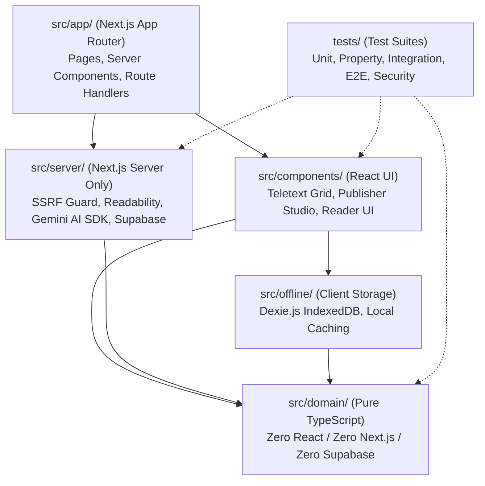

# PageCast — Application Directory Architecture & Boundary Guide

**Project:** PageCast — AI-Powered Low-Bandwidth Teletext Information Platform  
**Event:** Kiroween 2026 (Category: Resurrection)  
**Document Status:** Architectural Directory Layout Specification  
**Task Reference:** `TASK-S0-05`  
**Root Path:** `c:\Users\Atul2\OneDrive\Desktop\KiroHackethon\pagecast`  

---

## 1. Architectural Philosophy & Layer Separation

PageCast enforces strict structural separation between pure domain rules, server-side infrastructure, client-side rendering components, and offline storage.



---

## 2. Comprehensive Directory Tree

```text
pagecast/
├── .github/                           # CI/CD Workflows (GitHub Actions)
├── .kiro/                             # Kiro configuration (steering, specs, hooks)
├── docs/                              # Project discovery, specs, and sprint completion records
├── public/                            # Static assets (fonts, icons, manifest.webmanifest)
├── src/
│   ├── app/                           # Next.js App Router routes & layouts
│   │   ├── (reader)/                  # Public Reader route group
│   │   │   ├── catalogue/             # Public page catalogue browsing
│   │   │   ├── pages/[pageNumber]/    # Individual Teletext page view (100–899)
│   │   │   └── saved/                 # Saved offline pages library
│   │   ├── publisher/                 # Authenticated Publisher Studio
│   │   │   ├── compose/[id]/          # AI structured draft generator & review
│   │   │   ├── edit/[id]/             # 40x25 Teletext editor & byte budget meter
│   │   │   └── ingest/                # URL fetcher & raw text ingestion
│   │   ├── api/v1/                    # Versioned REST Route Handlers
│   │   │   ├── bulletins/compose/     # AI structured bulletin composition
│   │   │   ├── catalog/               # Public catalogue API
│   │   │   ├── import/validate/       # PagePack import validation
│   │   │   ├── pages/[pageNumber]/    # Public page fetch & PagePack download
│   │   │   └── sources/extract/       # SSRF-guarded URL extraction
│   │   ├── dev/design-tokens/         # Development-only visual token verification harness
│   │   ├── globals.css                # Tailwind 4 CSS-first design tokens & reset
│   │   ├── layout.tsx                 # Root HTML shell & metadata
│   │   └── page.tsx                   # Default root index landing page
│   ├── components/                    # Reusable React components
│   │   ├── dev/                       # Development-only inspection widgets
│   │   ├── publisher/                 # Studio dashboard, forms, approval modals
│   │   ├── qr/                        # Link QR, frame animated sequence, camera scanner
│   │   ├── reader/                    # Navigation toolbar, numpad, offline indicator
│   │   ├── teletext/                  # Deterministic 40x25 grid, rows, cells, CRT frame
│   │   └── ui/                        # Radix UI primitives & generic design tokens
│   ├── domain/                        # Pure TypeScript Domain Layer (Framework Agnostic)
│   │   ├── byte-budget/               # TextEncoder UTF-8 10 KiB calculation
│   │   ├── layout-engine/             # 40x25 line-wrapping & Intl.Segmenter graphemes
│   │   ├── page-pack/                 # PagePackV1 types and Zod schemas
│   │   ├── source-provenance/         # Source sentence ID mapping & attribution
│   │   └── validation/                # Invariant assertions (validateGrid, page-number)
│   ├── offline/                       # Local-first persistence
│   │   ├── db.ts                      # Dexie.js IndexedDB schema definition
│   │   ├── pack-import.ts             # SHA-256 verification & import validator
│   │   └── saved-pages.ts             # Save, list, and remove offline pages
│   ├── server/                        # Server-Only Modules (Secrets & Node.js APIS)
│   │   ├── ai/                        # Vercel AI SDK wrapper & extractive fallback
│   │   ├── auth/                      # Supabase SSR cookie auth & role authorization
│   │   ├── database/                  # Supabase Postgres client & typed queries
│   │   ├── ingestion/                 # Readability + jsdom HTML extraction
│   │   └── security/                  # SSRF prevention, IP blocklist, DNS re-check
│   └── lib/                           # Shared utility functions
└── tests/                             # Comprehensive automated test suites
    ├── e2e/                           # Playwright browser end-to-end scenarios
    ├── fixtures/                      # Seed PagePack JSON fixtures & mock HTML
    ├── integration/                   # API, DB, and multi-component tests
    ├── property/                      # fast-check property-based tests (P1–P8)
    ├── security/                      # SSRF, prompt injection, and innerHTML checks
    └── unit/                          # Pure unit tests for domain logic
```

---

## 3. Directory Responsibilities & Boundary Invariants

### 3.1 `src/domain/` (Pure TypeScript — Zero Framework Coupling)
- **Invariant:** MUST NEVER import from `react`, `next`, `@supabase/supabase-js`, or `ai`.
- **Purpose:** Houses all core business rules of PageCast:
  - Exact 40×25 logical grid calculation.
  - Unicode grapheme cluster segmentation via `Intl.Segmenter` (handling Hindi Devanagari conjuncts and matras).
  - Exact canonical UTF-8 byte counting via `TextEncoder` against the 10,240-byte ceiling.
  - Zod schemas for `PagePackV1`.
- **Testability:** Can execute inside any standard Node.js or browser environment with zero DOM or network dependencies.

### 3.2 `src/server/` (Node.js Server-Side Only)
- **Invariant:** MUST NEVER be imported by client components (use `"use server"` or route handlers).
- **Purpose:** Protects privileged operations and private secrets:
  - `server/security/url-safety.ts`: Resolves DNS, checks loopback/private/link-local/cloud-metadata addresses, restricts redirects, and prevents SSRF (`RISK-S01`).
  - `server/ingestion/`: Runs Mozilla Readability in `jsdom` with script execution explicitly disabled.
  - `server/ai/`: Interfaces with Google Gemini via Vercel AI SDK using server-only environment keys (`GOOGLE_GENERATIVE_AI_API_KEY`).
  - `server/auth/`: Validates Supabase sessions server-side using HTTP-only cookies.

### 3.3 `src/app/` (Next.js App Router)
- **Purpose:** Encapsulates the application routing structure:
  - `(reader)/`: Layout and views optimized for public, low-friction reading without authentication.
  - `publisher/`: Protected workspace for content creators.
  - `api/v1/`: Versioned JSON API endpoints for extraction, composition, and page publishing.
  - `dev/`: Internal development inspection routes gated to non-production environments.

### 3.4 `src/components/` (React UI Layer)
- **Purpose:** Houses modular, accessible UI presentation:
  - `teletext/`: Canvas rendering the 40×25 logical grid, scanline CRT frame, and screen-reader accessible alternative.
  - `reader/`: Keypad, navigation bar, and network status badges.
  - `publisher/`: Draft editor, live byte-budget meter, and approval confirmation modal.
  - `qr/`: Single-link QR generator and multi-frame animated canvas.

### 3.5 `src/offline/` (Client Storage Layer)
- **Purpose:** Manages device-local persistence:
  - Houses the Dexie.js database definition (`savedPages`, `catalogSnapshot`).
  - Implements offline PagePack retrieval when the network is unavailable.
  - Verifies whole-pack SHA-256 digests prior to committing imported content.

### 3.6 `tests/` (Quality & Verification Layer)
- **Purpose:** Strict isolation of automated test categories:
  - `unit/`: Fast unit tests for pure domain functions.
  - `property/`: Generative tests via `fast-check` asserting mathematical invariants (P1–P8).
  - `integration/`: Route handler and database integration tests.
  - `security/`: Dedicated attack simulations for SSRF, prompt injection, and XSS.
  - `e2e/`: Playwright browser journeys including offline simulation.
