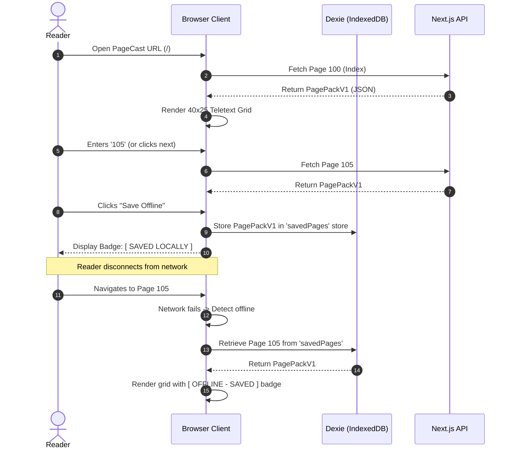
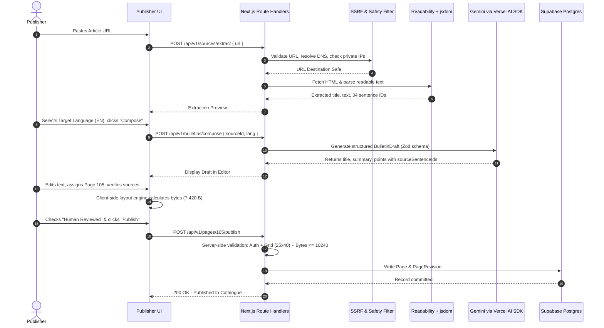

# PageCast — Sprint 0 Execution Plan
## Product Design, UI/UX & Technical Foundation

**Project:** PageCast — AI-Powered Low-Bandwidth Teletext Information Platform  
**Event:** Kiroween 2026 (Category: Resurrection)  
**Document Status:** Sprint 0 Execution Blueprint & Design Specifications  
**Author:** Principal Software Architect, Senior Business Analyst, Technical Product Manager & QA Architect  
**Target Duration:** 2 Days (30–31 October 2026)  
**Primary Reference:** `01_pagecast_project_spec_kiroween_2026.md` & `docs/` Phase 1 Deliverables  

---

## 1. Sprint 0 Objectives & Executive Summary

Sprint 0 establishes the complete visual design system, interaction architecture, developer environment, and Kiro automation infrastructure for PageCast. Because PageCast is being delivered by a solo developer over a strict 35-day timeline, Sprint 0 ensures that all design decisions, wireframes, component boundaries, and toolchains are locked **prior to writing domain or feature logic**.

### Primary Objectives

1. **Brand & Visual Identity:** Combine the authentic, high-contrast aesthetic of 1980s broadcast Teletext (Ceefax/Oracle inspired) with modern responsive web typography and accessibility standards.
2. **UX Architecture & Wireframing:** Produce concrete UI layouts and interaction specs for all 9 required screens, establishing deterministic layouts and clear user journeys.
3. **Repository & Next.js Foundation:** Configure a clean, unnested Next.js 16.x App Router application using TypeScript in strict mode, Tailwind CSS 4.x, and pnpm.
4. **Kiro Configuration:** Author the initial `.kiro/` steering guides, specs (`01-product-foundation`), and development hooks for automated linting, test enforcement, and byte-budget validation.
5. **Quality & CI Guardrails:** Stand up GitHub Actions CI for automated typechecking, linting, and build verification from commit zero.

---

## 2. Task A — Product & Visual Direction

### 2.1 Brand Identity & Logo Direction

PageCast revives broadcast Teletext for modern bandwidth-constrained and offline scenarios. The branding deliberately evokes the 1980s digital telecommunications era while asserting an original, modern identity:

- **Wordmark:** `PAGECAST` rendered in heavy, uppercase geometric monospace, optionally flanked by pixel-block signal bars `[▌▌] PAGECAST [▌▌]`.
- **Identity Stance:** Distinct, original identity. Never copy BBC, Ceefax, Oracle, or proprietary broadcast network logos.
- **Tagline:** *"Information should travel even when the internet cannot."*
- **App Icon (Favicon/PWA):** A vibrant yellow stylized page numeral `100` framed within a high-contrast cyan CRT television bezel on an obsidian background.

### 2.2 Color System & Teletext Palette

Teletext relies on a strict, high-contrast palette of 8 primary hues. PageCast adopts these classic colors mapped to exact, calibrated sRGB hex codes optimized for both OLED/LCD screens and WCAG 2.2 contrast compliance against dark surfaces.

#### Classic Teletext 8-Color Palette

| Color Token | Name | Hex Code | Semantic Role in PageCast | WCAG Contrast on Black (`#0a0a0c`) |
|---|---|---|---|---|
| `teletext-black` | Obsidian Screen | `#0a0a0c` | Default canvas background, outer terminal frame | Baseline (1.00:1) |
| `teletext-white` | Signal White | `#f8fafc` | Primary body text, default numerals, borders | 18.2:1 (AAA) |
| `teletext-yellow` | Broadcast Yellow | `#facc15` | Section headers, page numbers, active selections | 14.1:1 (AAA) |
| `teletext-cyan` | Teletext Cyan | `#06b6d4` | Metadata badges, hyperlinks, source attribution | 8.8:1 (AAA) |
| `teletext-green` | Phosphor Green | `#22c55e` | Success states, online indicator, valid byte count | 9.4:1 (AAA) |
| `teletext-magenta`| Signal Magenta | `#e11d48` | Category tags, alert highlights, secondary markers | 4.6:1 (AA) |
| `teletext-red` | Warning Red | `#ef4444` | Errors, over-budget indicators, offline notices | 4.9:1 (AA) |
| `teletext-blue` | Header Blue | `#2563eb` | Subtle row backing, decorative accent blocks | 3.5:1 (Large text only) |

#### Modern Neutral Tokens (Studio & Publisher UI)

| Token | Hex Code | Purpose |
|---|---|---|
| `surface-ground` | `#030712` | Viewport backdrop behind terminal |
| `surface-terminal` | `#0b0f19` | Teletext screen container |
| `surface-panel` | `#111827` | Publisher workspace cards & dialogs |
| `surface-border` | `#1f2937` | Modern structural dividing lines |
| `text-muted` | `#9ca3af` | Secondary labels, timestamp notes |

### 2.3 Typography System

The typography must solve two distinct problems:
1. **Teletext Grid:** Precise monospace alignment where 40 characters fit exactly into a single row.
2. **Bilingual Hindi/English:** Unicode grapheme cluster rendering where Devanagari conjuncts and matras render clearly without clipping or column distortion.

```
+-----------------------------------------------------------------------------+
| FONT STACK DEFINITIONS                                                      |
+-----------------------------------------------------------------------------+
| Grid Monospace (English):  'Noto Sans Mono', 'Courier New', monospace       |
| Grid Bilingual (Hindi):    'Noto Sans Devanagari', 'Noto Sans Mono', sans   |
| Publisher UI (Sans):       'Inter', -apple-system, BlinkMacSystemFont, sans  |
+-----------------------------------------------------------------------------+
```

#### Monospace Aspect Ratio & Sizing
- Teletext characters traditionally followed an approximate 1:2 or 5:8 aspect ratio (taller than wide).
- **Line Height:** Enforce `leading-none` or strict `1.25` multiplier on grid rows to prevent vertical drifting.
- **Font Feature Settings:** `font-feature-settings: "tnum" 1, "zero" 1` (tabular numerals, slashed zero).

### 2.4 Spacing, Layout Tokens & Grid Canvas

The Teletext canvas is an exact **40-column by 25-row logical grid** (1,000 logical character cells).

- **Grid Canvas Aspect Ratio:** 40 columns wide × 25 rows tall ≈ 1.6:1 (near 16:10 or 4:3 with CRT padding).
- **Row Allocation:**
  - **Row 1 (Header):** Masthead, Page Number (e.g. `P100`), Service Name `PAGECAST`, Timestamp/Date.
  - **Rows 2–24 (Content Canvas):** 23 lines reserved for bulletin headlines, summary text, bullet points, and source attribution.
  - **Row 25 (Navigation/Status):** Quick navigation shortcut hints (e.g. `100 INDEX | 200 NEWS | 900 HELP`), offline badge, or payload byte summary.
- **Padding:** 8px to 16px internal bezel padding on the terminal screen.

### 2.5 Responsive Behavior & Viewport Breakpoints

| Breakpoint | Target Device | Reader Grid Layout Strategy | Publisher Studio Layout |
|---|---|---|---|
| `< 640px` (Mobile) | 360×800, 390×844 | Terminal scales fluidly using CSS `clamp()` or `transform: scale()` to fit viewport width without horizontal scroll. Touch swipe / tap controls for page switching. | Single column stacked layout. Form inputs above live preview. Sticky bottom action bar. |
| `640px – 1023px` (Tablet) | 768×1024 | Native scale terminal centered in viewport with ambient CRT frame. On-screen numeric keypad toggleable. | 2-column layout (collapsible sidebar / draft editor). |
| `≥ 1024px` (Desktop) | 1366×768, 1920×1080 | Fixed-size pixel-perfect CRT terminal (e.g., 720px × 540px) with optional ambient glow. Side panel for source provenance and quick navigation. | Split-screen studio: Left pane = Source Ingestion & Editor; Right pane = Live Teletext 40×25 Preview + Live Byte Budget Gauge. |

### 2.6 Accessibility & Inclusive Design (WCAG 2.2 AA)

1. **Dual Representation:** Every Teletext page provides a hidden-by-default or tab-accessible semantic HTML text alternative (`<div role="region" aria-label="Accessible Bulletin Content">`) allowing screen readers (NVDA, VoiceOver, JAWS) to traverse headings, lists, and links sequentially.
2. **Contrast Guard:** All foreground/background color combinations in the default palette exceed 4.5:1 (AA for standard text) and 7.0:1 (AAA for bold/headers).
3. **Motion Sensitivity:** Any CRT scanline, flicker, or beam-sweep animations MUST be disabled when `@media (prefers-reduced-motion: reduce)` is active.
4. **Keyboard Operability:** Complete navigation feasible via keyboard alone (Numeric 0–9 for direct page entry, `ArrowUp`/`ArrowDown` for prev/next, `S` for Save Offline, `Q` for QR share). Focus indicators utilize a high-visibility 2px solid `teletext-yellow` outline with 2px offset.

---

## 3. Task B — User Experience Design & Screen Architecture

### 3.1 Screen Inventory & ASCII Wireframe References

#### Screen 1: Landing Page / Reader Home (`/`)
```
+--------------------------------------------------------------------------+
| [PAGECAST]                                        [Offline: 3 Saved] [Pub] |
|==========================================================================+
|                                                                          |
|   +------------------------------------------------------------------+   |
|   | P100 PAGECAST     30 OCT 2026 12:00:00                          |   |
|   | ---------------------------------------------------------------- |   |
|   | WELCOME TO PAGECAST: LOW-BANDWIDTH TELETEXT NEWS                |   |
|   |                                                                  |   |
|   | PageCast converts long web articles into 40x25 bulletins         |   |
|   | that fit inside a 10 KiB payload. Read online or offline.        |   |
|   |                                                                  |   |
|   | 101 WORLD NEWS SUMMARY                                           |   |
|   | 102 SCIENCE & TECH ROUNDUP                                       |   |
|   | 103 CAMPUS & LOCAL NOTICES                                       |   |
|   | 104 HINDI BULLETIN (हिंदी समाचार)                                |   |
|   |                                                                  |   |
|   | ---------------------------------------------------------------- |   |
|   | PRESS [PAGE NUMBER] OR USE BUTTONS BELOW                         |   |
|   +------------------------------------------------------------------+   |
|                                                                          |
|   [ < PREV ]  [ ENTER PAGE: ___ ]  [ GO ]  [ NEXT > ]  [ SAVE OFFLINE ]  |
+--------------------------------------------------------------------------+
```

#### Screen 2: Publisher Studio Dashboard (`/publisher`)
```
+--------------------------------------------------------------------------+
| PAGECAST STUDIO | Workspace: Default Publisher          [Sign Out]       |
+--------------------------------------------------------------------------+
|  [ + Ingest New Article ]   [ Paste Text Draft ]                         |
|--------------------------------------------------------------------------|
|  DRAFTS & BULLETINS                                                      |
|  +-----+-------------------------------+--------+---------+-----------+  |
|  | P#  | Title                         | Lang   | Payload | Status    |  |
|  +-----+-------------------------------+--------+---------+-----------+  |
|  | 101 | Global Climate Summit Accord  | EN     | 7,420 B | PUBLISHED |  |
|  | 104 | नई दिल्ली विज्ञान संगोष्ठी    | HI     | 8,110 B | PUBLISHED |  |
|  | 105 | Space Telescope New Discovery | EN     | 9,840 B | DRAFT     |  |
|  +-----+-------------------------------+--------+---------+-----------+  |
+--------------------------------------------------------------------------+
```

#### Screen 3: Source Ingestion Screen (`/publisher/ingest`)
```
+--------------------------------------------------------------------------+
| PAGECAST STUDIO > INGEST ARTICLE                                         |
+--------------------------------------------------------------------------+
|  SOURCE URL:                                                             |
|  [ https://example.org/news/quantum-breakthrough                   ]     |
|  [ Fetch & Extract HTML ]                                                |
|                                                                          |
|  - OR PASTE RAW TEXT -                                                   |
|  [                                                                ]     |
|  [                                                                ]     |
|                                                                          |
|  [X] Enforce SSRF & Domain Safety Checks (max 2 MiB, 8s timeout)         |
+--------------------------------------------------------------------------+
```

#### Screen 4: Extracted Content Preview & AI Compose (`/publisher/compose/:id`)
```
+--------------------------------------------------------------------------+
| STEP 1: REVIEW EXTRACTED SOURCE CONTENT                                  |
| Canonical URL: https://example.org/news/quantum-breakthrough             |
| Title: Scientists Achieve Room Temperature Superconductor Observation    |
| Extracted Sentences: 42 sentences identified                             |
|--------------------------------------------------------------------------|
| TARGET LANGUAGE: [ (o) English   ( ) Hindi ]                             |
| MAX KEY POINTS:  [ 4 ]                                                   |
|                                                                          |
| [ >>> Run AI Structured Bulletin Composer <<< ]                          |
| (Fallback: [ Extractive Summarizer Without AI ])                         |
+--------------------------------------------------------------------------+
```

#### Screen 5 & 6: Teletext Editor & Live Preview (`/publisher/edit/:id`)
```
+---------------------------------------+----------------------------------+
| EDITOR (Left Pane)                    | LIVE 40x25 PREVIEW (Right Pane)  |
|---------------------------------------|----------------------------------|
| Page Number: [ 105 ] (100-899)        | P105 PAGECAST   30 OCT 2026      |
| Title:                                | -------------------------------- |
| [ Room Temp Superconductor Claim   ]  | ROOM TEMP SUPERCONDUCTOR CLAIM   |
| Summary (max 200 chars):              |                                  |
| [ Researchers observe novel effect..] | Researchers observe novel        |
|                                       | magnetic resistance drop in..    |
| Section 1 Heading: [ KEY FINDINGS ]   |                                  |
| Point 1: [ Resistance dropped to 0 ]  | * KEY FINDINGS                   |
| Source Sentences: [ S03, S07 ]        | - Resistance dropped to 0 (S03)  |
|                                       | - Effect observed under 15 GPa   |
| ------------------------------------- | -------------------------------- |
| PAYLOAD BUDGET METER:                 | SOURCE: nature.com/articles/...  |
| [========                  ] 7,420 B  | -------------------------------- |
| Budget: 7,420 / 10,240 bytes (2,820 B | 100 INDEX | 104 PREV | 106 NEXT  |
| remaining). [ OK - READY ]            |                                  |
|                                       | [ Human Reviewed: [x] Checked ]  |
| [ Save Draft ]   [ Publish Page > ]   | [ Publish to P105 ]              |
+---------------------------------------+----------------------------------+
```

#### Screen 7: Reader Experience (`/pages/:pageNumber`)
- Focused, distraction-free CRT Teletext canvas with top navigation and bottom controls.
- Keyboard listeners for 0–9 direct numeric entry with a 2-second buffer indicator (e.g. `PAGE: 10_`).

#### Screen 8: Catalogue View (`/catalogue`)
- Grid listing of all available pages sorted by section:
  - 100s: Index & General Info
  - 200s: Current Affairs & News
  - 300s: Science & Technology
  - 400s: Community & Campus Notices
  - 500s: Hindi Regional Bulletins
- Each card indicates page number, title, language, payload size, and offline save status.

#### Screen 9: Offline, Stale & Error States
- **Offline Active State:** Yellow/green indicator toggles to cyan `[ OFFLINE MODE: LOCAL STORAGE ]`.
- **Cached Page Notice:** `[ SAVED CACHE - REVISION 2 (30 OCT 10:14) ]`.
- **Not Cached Offline State:** High-contrast retro error box:
  ```
  +------------------------------------------------+
  | 404 PAGE NOT FOUND IN LOCAL STORAGE            |
  | This page was not saved prior to disconnecting.|
  | [ Go to Saved Pages Library ]                  |
  +------------------------------------------------+
  ```

### 3.2 User Journeys

#### Journey 1: Reader Browsing & Offline Saving


#### Journey 2: Publisher Article Ingestion to Publish


---

## 4. Reusable Component Hierarchy & Architecture

```mermaid
graph TD
    RootLayout[src/app/layout.tsx] --> AppShell[AppShell Header/Footer]
    
    AppShell --> ReaderRoute[src/app/(reader)/page.tsx]
    AppShell --> PublisherRoute[src/app/publisher/page.tsx]
    
    subgraph TeletextEngine["src/components/teletext/ (Deterministic UI)"]
        GridContainer[TeletextGridContainer]
        CRTBezel[CRTBezelFrame / Canvas]
        RowRenderer[TeletextRow x25]
        CellRenderer[TeletextCell x40]
        AccessibleView[AccessibleScreenReaderView]
        
        GridContainer --> CRTBezel
        CRTBezel --> RowRenderer
        RowRenderer --> CellRenderer
        GridContainer --> AccessibleView
    end

    subgraph ReaderUI["src/components/reader/"]
        ReaderControls[ReaderNavToolbar]
        Numpad[NumericKeypad]
        OfflineBadge[NetworkStatusBadge]
        CatalogueGrid[CatalogueCardList]
    end

    subgraph PublisherUI["src/components/publisher/"]
        SourceForm[SourceInputForm]
        ExtractedViewer[ExtractedSourceViewer]
        DraftEditor[BulletinDraftEditor]
        ByteMeter[ByteBudgetMeter]
        PublishGate[PublishApprovalModal]
    end

    subgraph QRUI["src/components/qr/"]
        LinkQRModal[LinkQRCodeModal]
        JSONExportBtn[PagePackJSONExporter]
        FrameScanner[MultiFrameScanner P1]
    end

    ReaderRoute --> GridContainer
    ReaderRoute --> ReaderControls
    ReaderControls --> Numpad
    ReaderControls --> OfflineBadge
    ReaderControls --> LinkQRModal

    PublisherRoute --> SourceForm
    PublisherRoute --> ExtractedViewer
    PublisherRoute --> DraftEditor
    DraftEditor --> GridContainer
    DraftEditor --> ByteMeter
    DraftEditor --> PublishGate
```

---

## 5. Task C — Technical Foundation & Repository Setup

### 5.1 Root Directory Layout (Preventing Nested Repos)

The root folder is `c:\Users\Atul2\OneDrive\Desktop\KiroHackethon\pagecast`.  
**Under no circumstances should a nested `pagecast/pagecast` directory be created.**

```text
pagecast/
├── .github/
│   └── workflows/
│       └── ci.yml                     # Automated Lint, Typecheck, Build
├── .kiro/
│   ├── steering/
│   │   ├── product.md
│   │   ├── architecture.md
│   │   ├── coding-standards.md
│   │   ├── ui-ux.md
│   │   ├── security.md
│   │   ├── teletext-domain.md
│   │   └── testing.md
│   ├── specs/
│   │   └── 01-product-foundation/
│   │       └── spec.md
│   └── hooks/
│       ├── lint-on-save.json
│       ├── renderer-tests.json
│       ├── page-budget-check.json
│       └── pre-submit-check.json
├── docs/                              # Phase 1 + Sprint 0 Deliverables
├── public/
│   ├── fonts/                         # Noto Sans Mono & Devanagari TTF/WOFF2
│   ├── icons/                         # PWA icons (192x192, 512x512)
│   └── manifest.webmanifest
├── src/
│   ├── app/
│   │   ├── (reader)/
│   │   │   ├── catalogue/page.tsx
│   │   │   ├── pages/[pageNumber]/page.tsx
│   │   │   ├── saved/page.tsx
│   │   │   └── page.tsx               # Index (Page 100)
│   │   ├── publisher/
│   │   │   ├── compose/[id]/page.tsx
│   │   │   ├── edit/[id]/page.tsx
│   │   │   ├── ingest/page.tsx
│   │   │   └── page.tsx               # Studio Dashboard
│   │   ├── api/v1/
│   │   │   ├── bulletins/compose/route.ts
│   │   │   ├── catalog/route.ts
│   │   │   ├── import/validate/route.ts
│   │   │   ├── pages/[pageNumber]/pack/route.ts
│   │   │   ├── pages/[pageNumber]/route.ts
│   │   │   ├── pages/[pageNumber]/publish/route.ts
│   │   │   ├── pages/route.ts
│   │   │   ├── sources/extract/route.ts
│   │   │   └── sources/from-text/route.ts
│   │   ├── globals.css
│   │   └── layout.tsx
│   ├── components/
│   │   ├── publisher/
│   │   ├── qr/
│   │   ├── reader/
│   │   ├── teletext/
│   │   └── ui/                        # Radix/Tailwind building blocks
│   ├── domain/                        # Pure TS - Zero Framework Imports
│   │   ├── byte-budget/
│   │   │   └── measure.ts             # TextEncoder UTF-8 measurement
│   │   ├── layout-engine/
│   │   │   ├── graphemes.ts           # Intl.Segmenter logic
│   │   │   └── layout.ts              # 40x25 grid wrapping
│   │   ├── page-pack/
│   │   │   ├── schema.ts              # PagePackV1 Zod schema
│   │   │   └── types.ts
│   │   ├── source-provenance/
│   │   │   └── types.ts
│   │   └── validation/
│   │       ├── page-number.ts
│   │       └── validate-grid.ts       # 25x40 invariant checker
│   ├── offline/
│   │   ├── db.ts                      # Dexie schema
│   │   ├── pack-import.ts
│   │   └── saved-pages.ts
│   ├── server/
│   │   ├── ai/
│   │   │   ├── composer.ts
│   │   │   └── extractive-fallback.ts
│   │   ├── auth/
│   │   │   └── middleware.ts
│   │   ├── database/
│   │   │   ├── client.ts
│   │   │   └── types.ts
│   │   ├── ingestion/
│   │   │   ├── extractor.ts
│   │   │   └── sentence-ids.ts
│   │   └── security/
│   │       └── url-safety.ts          # SSRF defense & DNS resolution
│   └── lib/
│       └── utils.ts
├── tests/
│   ├── e2e/
│   ├── fixtures/
│   ├── integration/
│   ├── property/
│   ├── security/
│   └── unit/
├── .env.example
├── .eslintrc.json
├── .gitignore
├── LICENSE
├── package.json
├── pnpm-lock.yaml
├── postcss.config.mjs
├── README.md
└── tsconfig.json
```

### 5.2 Next.js 16 & TypeScript Configuration

#### `tsconfig.json`
```json
{
  "compilerOptions": {
    "target": "ES2022",
    "lib": ["dom", "dom.iterable", "esnext"],
    "allowJs": true,
    "skipLibCheck": true,
    "strict": true,
    "noEmit": true,
    "esModuleInterop": true,
    "module": "esnext",
    "moduleResolution": "bundler",
    "resolveJsonModule": true,
    "isolatedModules": true,
    "jsx": "preserve",
    "incremental": true,
    "plugins": [{ "name": "next" }],
    "paths": {
      "@/*": ["./src/*"]
    }
  },
  "include": ["next-env.d.ts", "**/*.ts", "**/*.tsx", ".next/types/**/*.ts"],
  "exclude": ["node_modules"]
}
```

### 5.3 Tailwind CSS 4.x Configuration

Tailwind 4 uses CSS-first configuration via `@import "tailwindcss";` in `src/app/globals.css`. Custom Teletext theme colors and tokens are declared cleanly:

```css
@import "tailwindcss";

@theme {
  --color-teletext-black: #0a0a0c;
  --color-teletext-white: #f8fafc;
  --color-teletext-yellow: #facc15;
  --color-teletext-cyan: #06b6d4;
  --color-teletext-green: #22c55e;
  --color-teletext-magenta: #e11d48;
  --color-teletext-red: #ef4444;
  --color-teletext-blue: #2563eb;
  
  --font-mono: 'Noto Sans Mono', monospace;
  --font-hindi: 'Noto Sans Devanagari', 'Noto Sans Mono', sans-serif;
}
```

### 5.4 Package Management & Dependency Surface

Using `pnpm` with committed `pnpm-lock.yaml`.

#### Core Production Dependencies
- `next`: `^16.0.0`
- `react`, `react-dom`: Supported React version (React 19)
- `zod`: `^3.24.0` (Schema validation across all layers)
- `@supabase/supabase-js`, `@supabase/ssr`: Postgres & cookie auth
- `ai`, `@ai-sdk/google`: Vercel AI SDK provider abstraction
- `@mozilla/readability`, `jsdom`: Article HTML extraction
- `dexie`: `^4.0.0` (Typed IndexedDB client)
- `qrcode`: `^1.5.0` (QR Generation)
- `@zxing/browser`: `^0.1.5` (QR Camera Scanning)
- `lucide-react`: UI icon set

#### Development & Testing Dependencies
- `typescript`, `@types/node`, `@types/react`, `@types/react-dom`, `@types/jsdom`, `@types/qrcode`
- `tailwindcss`, `@tailwindcss/postcss`, `postcss`
- `eslint`, `eslint-config-next`, `prettier`
- `vitest`: Unit & integration testing
- `fast-check`: Property-based testing
- `@playwright/test`: E2E automated browser testing
- `@axe-core/playwright`: Automated WCAG accessibility verification

### 5.5 Environment Configuration (`.env.example`)

```env
# PageCast Public Configuration
NEXT_PUBLIC_APP_URL=http://localhost:3000
NEXT_PUBLIC_SUPABASE_URL=https://your-project.supabase.co
NEXT_PUBLIC_SUPABASE_ANON_KEY=your-supabase-anon-key

# Server-Only Secrets (NEVER prefix with NEXT_PUBLIC_)
SUPABASE_SERVICE_ROLE_KEY=your-supabase-service-role-key
GOOGLE_GENERATIVE_AI_API_KEY=your-google-ai-api-key

# AI Provider Configuration
PAGECAST_AI_PROVIDER=google
PAGECAST_AI_MODEL=gemini-1.5-flash
PAGECAST_PROMPT_VERSION=1

# Engine & Payload Limits
PAGECAST_MAX_PACK_BYTES=10240
PAGECAST_MAX_SOURCE_BYTES=2097152
PAGECAST_FETCH_TIMEOUT_MS=8000
PAGECAST_MAX_REDIRECTS=3
```

### 5.6 CI Workflow (`.github/workflows/ci.yml`)

```yaml
name: PageCast CI

on:
  push:
    branches: [ main, develop ]
  pull_request:
    branches: [ main ]

jobs:
  validate:
    runs-on: ubuntu-latest
    steps:
      - uses: actions/checkout@v4

      - name: Install pnpm
        uses: pnpm/action-setup@v3
        with:
          version: 9

      - name: Setup Node.js
        uses: actions/setup-node@v4
        with:
          node-version: 20
          cache: 'pnpm'

      - name: Install dependencies
        run: pnpm install --frozen-lockfile

      - name: Typecheck
        run: pnpm tsc --noEmit

      - name: Lint
        run: pnpm lint

      - name: Unit & Property Tests
        run: pnpm test:run

      - name: Build Application
        run: pnpm build
        env:
          NEXT_PUBLIC_APP_URL: http://localhost:3000
          NEXT_PUBLIC_SUPABASE_URL: https://mock.supabase.co
          NEXT_PUBLIC_SUPABASE_ANON_KEY: mock-anon-key
```

---

## 6. Task D — Kiro Development Configuration Plan

### 6.1 Steering Documents (`.kiro/steering/`)

The steering files guide autonomous coding agents to maintain architecture integrity:

1. **`product.md`**: Mission, 10 KiB PagePack payload budget definition, human-in-the-loop requirement, non-goals.
2. **`architecture.md`**: Next.js App Router boundaries, pure TypeScript domain layer rules, offline local-first model.
3. **`coding-standards.md`**: TypeScript strict conventions, no implicit `any`, small pure functions, Zod parsing patterns.
4. **`ui-ux.md`**: 40×25 logical grid rules, Teletext 8-color palette, WCAG 2.2 contrast compliance, prefers-reduced-motion.
5. **`security.md`**: SSRF prevention in URL ingestion, zero client secrets, prompt injection defense, XSS avoidance.
6. **`teletext-domain.md`**: Invariants of 40×25 layout, `Intl.Segmenter` grapheme rules for Hindi Devanagari, byte-budget calculations.
7. **`testing.md`**: Test pyramids, property-based testing properties (P1–P8), Playwright offline tests.

### 6.2 Specification Foundation (`.kiro/specs/01-product-foundation/spec.md`)

Defines the system boundaries, MVP milestones, persona journeys, and base acceptance criteria matching requirements `FR-001` through `SUB-010`.

### 6.3 Agent Hooks Configuration (`.kiro/hooks/`)

#### 1. `lint-on-save.json`
Runs ESLint upon saving files matching `src/**/*.{ts,tsx}`.

#### 2. `renderer-tests.json`
Automatically triggers `vitest run tests/unit/domain` and `tests/property/` whenever files in `src/domain/layout-engine/**` or `src/domain/page-pack/**` are modified.

#### 3. `page-budget-check.json`
Runs canonical byte-budget regression tests whenever `src/domain/byte-budget/**` changes.

#### 4. `pre-submit-check.json`
Full gate: runs `tsc --noEmit`, `eslint`, `vitest run`, and `next build` before PR creation or branch release.

---

## 7. Task E — Implementation Tasks & Execution Sequence

Sprint 0 is executed in 12 structured tasks across 2 calendar days.

```
+------------------------------------------------------------------------------------+
| SPRINT 0 EXECUTION ROADMAP                                                         |
+------------------------------------------------------------------------------------+
| DAY 1: Foundation, Toolchain & CI Setup                                            |
|   TASK-S0-01: Git & Root Directory Sanitization                                    |
|   TASK-S0-02: Next.js 16 Bootstrap & TypeScript Strict Config                      |
|   TASK-S0-03: Tailwind CSS 4.x Setup & Teletext Theme Tokens                       |
|   TASK-S0-04: ESLint, Prettier & Code Quality Setup                                |
|   TASK-S0-05: Project Directory Scaffolding                                        |
|   TASK-S0-06: Environment & Secret Isolation Config                                |
|   TASK-S0-07: GitHub Actions CI Pipeline Setup                                     |
+------------------------------------------------------------------------------------+
| DAY 2: Kiro Configuration, Design Tokens & Domain Scaffolding                      |
|   TASK-S0-08: Kiro Steering Documents Creation                                     |
|   TASK-S0-09: Kiro Spec 01-product-foundation Creation                             |
|   TASK-S0-10: Kiro Development Hooks Setup                                         |
|   TASK-S0-11: Testing Infrastructure (Vitest & fast-check Setup)                   |
|   TASK-S0-12: Sprint 0 Quality Verification & Milestone Gate                       |
+------------------------------------------------------------------------------------+
```

### Detailed Task Specifications

#### TASK-S0-01: Git & Root Directory Sanitization
- **Objective:** Initialize Git tracking in the actual repository root, create `.gitignore`, and ensure no nested directories exist.
- **Dependencies:** None.
- **Files Modified/Created:** `.git/`, `.gitignore`, `LICENSE`.
- **Implementation:** Run `git init`. Commit `.gitignore` with `node_modules`, `.next/`, `.env*` (except `.env.example`), `coverage/`.
- **Acceptance Criteria:** `git status` displays correct root status. All Phase 1 docs preserved.
- **Definition of Done:** Initial clean commit created.

#### TASK-S0-02: Next.js 16 Bootstrap & TypeScript Strict Config
- **Objective:** Bootstrap Next.js 16 App Router directly into the root workspace with TypeScript.
- **Dependencies:** TASK-S0-01.
- **Files Modified/Created:** `package.json`, `tsconfig.json`, `next.config.ts`, `src/app/layout.tsx`, `src/app/page.tsx`.
- **Implementation:** Install Next.js 16, React, TypeScript. Configure `tsconfig.json` with strict mode, `@/*` aliases, and Node 20 / ES2022 compatibility.
- **Acceptance Criteria:** `pnpm tsc --noEmit` exits with status 0.
- **Definition of Done:** Next.js dev server runs locally without warnings.

#### TASK-S0-03: Tailwind CSS 4.x Setup & Teletext Theme Tokens
- **Objective:** Install Tailwind CSS 4.x and define the complete 8-color Teletext palette and typography tokens.
- **Dependencies:** TASK-S0-02.
- **Files Modified/Created:** `postcss.config.mjs`, `src/app/globals.css`.
- **Implementation:** Configure `@import "tailwindcss";` and `@theme` definitions for `teletext-black`, `teletext-white`, `teletext-yellow`, `teletext-cyan`, `teletext-green`, `teletext-magenta`, `teletext-red`, and `teletext-blue`.
- **Acceptance Criteria:** Utility classes (e.g. `bg-teletext-black text-teletext-yellow`) compile cleanly in test component.
- **Definition of Done:** Test page displays verified Teletext color palette in browser.

#### TASK-S0-04: ESLint, Prettier & Code Quality Setup
- **Objective:** Establish unified formatting and lint rules enforcing accessibility and clean TypeScript.
- **Dependencies:** TASK-S0-02.
- **Files Modified/Created:** `.eslintrc.json`, `.prettierrc`.
- **Implementation:** Configure `eslint-config-next` with rules preventing unused variables, enforcing explicit return types on domain functions, and blocking `dangerouslySetInnerHTML`.
- **Acceptance Criteria:** `pnpm lint` runs cleanly across all files.
- **Definition of Done:** Zero lint errors across the workspace.

#### TASK-S0-05: Project Directory Scaffolding
- **Objective:** Create the complete target folder architecture matching the spec and architectural blueprint.
- **Dependencies:** TASK-S0-02.
- **Files Modified/Created:** `src/domain/`, `src/server/`, `src/components/`, `src/offline/`, `src/lib/`, `tests/`.
- **Implementation:** Create placeholder files (`index.ts` / `.gitkeep`) across all domain, server, component, and test directories to ensure git retention and import path clarity.
- **Acceptance Criteria:** Folder structure matches Section 5.1 exactly.
- **Definition of Done:** Clean directory structure committed.

#### TASK-S0-06: Environment & Secret Isolation Config
- **Objective:** Define `.env.example` with exact variable names and establish secret-leak protection.
- **Dependencies:** TASK-S0-01.
- **Files Modified/Created:** `.env.example`.
- **Implementation:** Document all Supabase, Google AI, and operational environment variables. Verify no private secrets contain `NEXT_PUBLIC_`.
- **Acceptance Criteria:** `.env` is ignored by Git; `.env.example` contains placeholders only.
- **Definition of Done:** Secret scan confirms zero credentials in git history.

#### TASK-S0-07: GitHub Actions CI Pipeline Setup
- **Objective:** Implement the automated build, typecheck, and test gate on GitHub Actions.
- **Dependencies:** TASK-S0-02, TASK-S0-04.
- **Files Modified/Created:** `.github/workflows/ci.yml`.
- **Implementation:** Author workflow using Node 20 and pnpm caching. Execute typecheck, lint, test, and build.
- **Acceptance Criteria:** Workflow passes cleanly in GitHub repository.
- **Definition of Done:** Green CI check badge on repository main branch.

#### TASK-S0-08: Kiro Steering Documents Creation
- **Objective:** Create all 7 Kiro steering files in `.kiro/steering/`.
- **Dependencies:** TASK-S0-01.
- **Files Modified/Created:** `.kiro/steering/*.md` (7 files).
- **Implementation:** Author `product.md`, `architecture.md`, `coding-standards.md`, `ui-ux.md`, `security.md`, `teletext-domain.md`, and `testing.md`.
- **Acceptance Criteria:** All files adhere to Kiro steering conventions and reflect Phase 1 decisions.
- **Definition of Done:** 7 markdown files committed in `.kiro/steering/`.

#### TASK-S0-09: Kiro Spec 01-product-foundation Creation
- **Objective:** Create the initial foundational Kiro specification document.
- **Dependencies:** TASK-S0-08.
- **Files Modified/Created:** `.kiro/specs/01-product-foundation/spec.md`.
- **Implementation:** Encode user personas, journeys, requirements traceability IDs, and MVP acceptance criteria.
- **Acceptance Criteria:** Spec is readable by Kiro and matches Phase 1 documentation.
- **Definition of Done:** Spec file committed and ready for task linking.

#### TASK-S0-10: Kiro Development Hooks Setup
- **Objective:** Configure agent automation hooks for linting, testing, and byte-budget enforcement.
- **Dependencies:** TASK-S0-08.
- **Files Modified/Created:** `.kiro/hooks/*.json` (4 hooks).
- **Implementation:** Author JSON configurations for `lint-on-save`, `renderer-tests`, `page-budget-check`, and `pre-submit-check`.
- **Acceptance Criteria:** Hook JSON schemas match Kiro hook definitions.
- **Definition of Done:** 4 hooks saved in `.kiro/hooks/`.

#### TASK-S0-11: Testing Infrastructure (Vitest & fast-check Setup)
- **Objective:** Stand up the test harness for unit, integration, and property-based testing.
- **Dependencies:** TASK-S0-02.
- **Files Modified/Created:** `vitest.config.ts`, `tests/unit/smoke.test.ts`, `tests/property/smoke.property.test.ts`.
- **Implementation:** Configure Vitest to resolve `@/*` aliases and execute both standard unit tests and `fast-check` properties. Include basic smoke assertions.
- **Acceptance Criteria:** `pnpm test` runs and passes smoke tests.
- **Definition of Done:** Vitest and fast-check execute cleanly in CI.

#### TASK-S0-12: Sprint 0 Quality Verification & Milestone Gate
- **Objective:** Execute full validation across all Sprint 0 deliverables.
- **Dependencies:** All previous Sprint 0 tasks.
- **Files Modified/Created:** `docs/SPRINT_0_COMPLETION_REPORT.md` (at completion).
- **Implementation:** Run typecheck, lint, test, build, and verify that all Phase 1 and Sprint 0 documents remain uncorrupted.
- **Acceptance Criteria:** All commands pass with zero errors. All criteria in Section 11 satisfied.
- **Definition of Done:** Sprint 0 declared complete; repo ready for Sprint 1.

---

## 8. Task F — Testing Strategy & Quality Assurance

Sprint 0 validates the development infrastructure before any business logic is introduced.

### 8.1 Typechecking & Compilation
- **Command:** `pnpm tsc --noEmit`
- **Scope:** Complete project including all config files and test files.
- **Gate:** Zero TypeScript errors permitted.

### 8.2 Code Style & Linting
- **Command:** `pnpm lint`
- **Scope:** Enforce React hooks rules, Next.js optimization recommendations, and accessibility standards.

### 8.3 Smoke & Property Test Harness
- **Vitest Unit Smoke Test:** Verify environment and alias resolution (`@/lib/utils`).
- **fast-check Property Smoke Test:** Generate 1,000 arbitrary integer arrays to verify property-based execution and reporter functioning.

### 8.4 Production Build Verification
- **Command:** `pnpm build`
- **Scope:** Next.js static asset compilation and server bundle generation. Confirms that no browser-incompatible dependencies are included in client routes.

### 8.5 Viewport & Theme Verification
- Visual inspection of the test layout across 5 standard breakpoints (360px, 390px, 768px, 1366px, 1920px) confirming that font loading and color tokens render accurately.

---

## 9. Dependencies & Execution Timeline

```
+-----------------------------------------------------------------------------+
| TASK DEPENDENCY MATRIX                                                      |
+-----------------------------------------------------------------------------+
| TASK-S0-01 (Git / Root)                                                     |
|      ↓                                                                      |
| TASK-S0-02 (Next.js 16 / TS) ──→ TASK-S0-06 (Env)                           |
|      ↓                                                                      |
| TASK-S0-03 (Tailwind 4)      ──→ TASK-S0-04 (ESLint / Prettier)             |
|      ↓                                 ↓                                    |
| TASK-S0-05 (Scaffolding)     ──→ TASK-S0-07 (GitHub CI)                     |
|      ↓                                 ↓                                    |
| TASK-S0-08 (Kiro Steering)   ──→ TASK-S0-11 (Vitest / fast-check)           |
|      ↓                                 ↓                                    |
| TASK-S0-09 (Kiro Spec)       ──→ TASK-S0-10 (Kiro Hooks)                    |
|      ↓                                 ↓                                    |
|               TASK-S0-12 (Sprint 0 Final Gate)                              |
+-----------------------------------------------------------------------------+
```

### Estimated Effort Breakdown (Solo Developer)

| Task ID | Description | Estimated Hours |
|---|---|---|
| TASK-S0-01 | Git & Root Directory Sanitization | 0.5 h |
| TASK-S0-02 | Next.js 16 Bootstrap & TypeScript Strict Config | 1.0 h |
| TASK-S0-03 | Tailwind CSS 4.x Setup & Teletext Theme Tokens | 1.0 h |
| TASK-S0-04 | ESLint, Prettier & Code Quality Setup | 0.5 h |
| TASK-S0-05 | Project Directory Scaffolding | 0.5 h |
| TASK-S0-06 | Environment & Secret Isolation Config | 0.5 h |
| TASK-S0-07 | GitHub Actions CI Pipeline Setup | 1.0 h |
| TASK-S0-08 | Kiro Steering Documents Creation (7 files) | 2.5 h |
| TASK-S0-09 | Kiro Spec 01-product-foundation Creation | 1.5 h |
| TASK-S0-10 | Kiro Development Hooks Setup (4 hooks) | 1.0 h |
| TASK-S0-11 | Testing Infrastructure (Vitest & fast-check) | 1.0 h |
| TASK-S0-12 | Sprint 0 Quality Verification & Milestone Gate | 1.0 h |
| **Total** | **Sprint 0 Execution Effort** | **12.0 h** |

---

## 10. Risk Mitigation & Edge Case Handling (Sprint 0 Focus)

| Risk ID | Identified Risk | Sprint 0 Proactive Defense | Contingency Action |
|---|---|---|---|
| **RISK-T01** | Hindi Devanagari grapheme rendering distortion | Specify `Noto Sans Devanagari` font fallback tokens in Tailwind 4 config immediately in Sprint 0. | If Devanagari font rendering exhibits vertical drift, lock CSS line-height to explicit unitless multiplier `1.2`. |
| **RISK-T02** | Serwist / Next.js 16 incompatibility | Do not install Serwist in Sprint 0. Defer service-worker integration to Sprint 4 while architecting static assets cleanly in `public/`. | If Serwist fails in Sprint 4, deploy official Next.js manual Service Worker script (`public/sw.js`). |
| **RISK-T03** | 10 KiB QR capacity mismatch | Design UI wireframes showing both Link QR (P0) and JSON file export (P0) as first-class actions. | Ensure UI never displays single-frame QR as capable of holding a full 10 KiB PagePack. |
| **RISK-S01** | SSRF vulnerability in article fetcher | Design `src/server/security/url-safety.ts` architecture boundary during scaffolding. | Prepare DNS resolution module ahead of Sprint 2 implementation. |
| **RISK-S02** | Secret exposure in client bundle | Enforce strict naming conventions in `.env.example`. Configure ESLint rule blocking `process.env.SUPABASE_SERVICE_ROLE_KEY` in client components. | If a secret is ever checked in, rotate immediately and rewrite git history using `git-filter-repo`. |

---

## 11. Definition of Done (DoD) for Sprint 0

Sprint 0 is formally complete only when all the following conditions are verified:

- [ ] **Git Repository:** Initialized cleanly at the true project root; no nested `pagecast` directories exist.
- [ ] **Next.js & TypeScript:** Next.js 16.x App Router builds with zero errors under `strict: true`.
- [ ] **Tailwind 4 Theme:** Complete 8-color Teletext palette and font families configured and verified in `src/app/globals.css`.
- [ ] **Code Quality:** `pnpm lint` and `pnpm tsc --noEmit` exit with zero warnings or errors.
- [ ] **Directory Architecture:** All domain, server, component, offline, and test directories scaffolded matching Section 5.1.
- [ ] **Test Harness:** Vitest and fast-check configured; smoke tests passing.
- [ ] **Kiro Infrastructure:** 7 steering documents committed in `.kiro/steering/`; `01-product-foundation` spec committed; 4 development hooks configured in `.kiro/hooks/`.
- [ ] **CI Pipeline:** `.github/workflows/ci.yml` configured and verified.
- [ ] **Documentation Integrity:** All 7 Phase 1 documents and `01_pagecast_project_spec_kiroween_2026.md` remain completely intact.
- [ ] **Implementation Boundary:** Zero feature code (Teletext layout engine, article fetcher, AI composer) written in Sprint 0.

---

*Plan complete. Ready for developer review prior to initiating Sprint 0 execution.*

