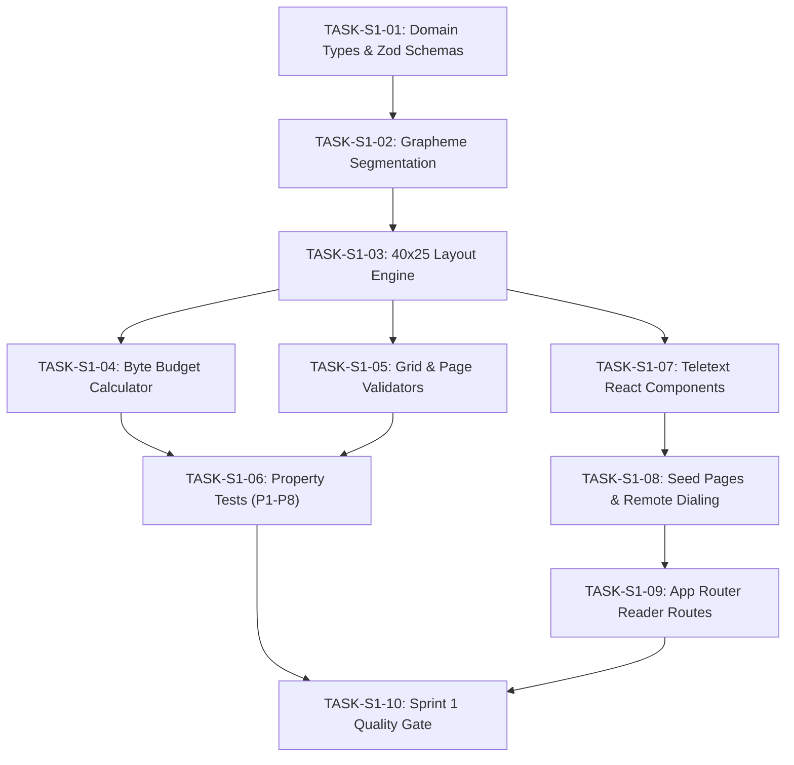

# PageCast — Sprint 1 Execution Plan
## Core Teletext Engine & Web Terminal

**Sprint:** Sprint 1  
**Dates:** Days 3–4 (Milestone 1)  
**Goal:** Build the visual and logical heart of PageCast (pure TypeScript domain engine, 40×25 grid layout, 10 KiB byte budget, Web Teletext CRT terminal, keyboard dialing, and seed pages) before introducing AI composition or database persistence.  
**Repository Root:** `C:\Users\Atul2\OneDrive\Desktop\KiroHackethon\pagecast`  
**Status:** Approved for Execution  

---

## 1. Architectural Principles & Constraints

1. **Pure Domain Independence:** All layout, validation, grapheme segmentation, and budget calculation modules inside `src/domain/` MUST be pure TypeScript functions with zero dependencies on React, Next.js, or browser DOM APIs.
2. **Canonical 40×25 Geometry:**
   - Exactly **25 rows** per page canvas.
   - Exactly **40 logical character cells** per row.
   - **Row 1 (index 0):** Header row (`P[Page]  PAGECAST  [Day] [Date]  [HH:MM:SS]`).
   - **Rows 2–24 (indices 1–23):** 23 usable content rows.
   - **Row 25 (index 24):** Navigation, source hint, or Fastext bar (`RED: ... GRN: ... YEL: ... CYN: ...`).
3. **Canonical 10 KiB Byte Budget:** Maximum serialized PagePack size is strictly **10,240 UTF-8 bytes** (`PAGECAST_MAX_PACK_BYTES=10240`), measured via `new TextEncoder().encode(JSON.stringify(pack)).byteLength`.
4. **Unicode & Hindi Grapheme Safety:** Grapheme clusters (especially Devanagari matras, conjuncts, and viramas) must never be split across cells or line boundaries.
5. **Accessibility (WCAG 2.1 AA):** Every visual CRT grid must be paired with an accessible, semantic screen-reader text alternative (`AccessibleAlternative`).

---

## 2. Sprint 1 Task Breakdown & Dependency Graph

---

## 3. Detailed Task Specifications

### TASK-S1-01: Core Teletext Domain Types & Zod Schemas
- **Purpose:** Define standard TypeScript interfaces and runtime Zod schemas for all Teletext data structures.
- **Requirements Covered:** `TR-001`, `FR-001`, `FR-002`, `FR-009`, `FR-055`, `FR-056`.
- **Dependencies:** None (Sprint 0 complete).
- **Files to Create/Modify:**
  - `src/domain/teletext/types.ts`
  - `src/domain/page-pack/schema.ts`
  - `src/domain/page-pack/types.ts`
  - `tests/unit/domain/schema.test.ts`
  - `package.json` (add `zod`)
- **Implementation Steps:**
  1. Install `zod` via `pnpm add zod`.
  2. Define `TeletextColor` union (`'black' | 'white' | 'red' | 'green' | 'yellow' | 'blue' | 'magenta' | 'cyan'`).
  3. Define `TeletextSpan`, `TeletextRow`, `TeletextPage`, and `FastextLinks`.
  4. Define `PagePackV1Schema` with Zod including metadata, page arrays, and versioning.
  5. Add unit tests asserting validation on valid and invalid payloads.
- **Acceptance Criteria:** `z.infer<typeof PagePackV1Schema>` parses valid packs and throws clear Zod errors on missing fields or invalid color strings.
- **Tests to Run:** `pnpm test:run tests/unit/domain/schema.test.ts`.

---

### TASK-S1-02: Unicode-Aware Grapheme Segmentation & Text Measurement
- **Purpose:** Accurately segment text into user-perceived grapheme clusters using `Intl.Segmenter` so that combining marks, Devanagari conjuncts, and emojis are never split.
- **Requirements Covered:** `FR-010`, `TR-003`, `NFR-016`.
- **Dependencies:** TASK-S1-01.
- **Files to Create/Modify:**
  - `src/domain/layout-engine/graphemes.ts`
  - `tests/unit/domain/graphemes.test.ts`
- **Implementation Steps:**
  1. Implement `segmentGraphemes(text: string): readonly string[]` using standard `Intl.Segmenter(locale, { granularity: 'grapheme' })`.
  2. Implement `getGraphemeCount(text: string): number`.
  3. Implement `sliceByGraphemes(text: string, maxGraphemes: number): string`.
  4. Add unit tests covering ASCII, Latin diacritics, Devanagari Hindi text (`पेजकास्ट`, `नमस्ते`, `भारत`), and emojis.
- **Acceptance Criteria:** Zero severed combining characters; Hindi words measure accurate visual cluster lengths.
- **Tests to Run:** `pnpm test:run tests/unit/domain/graphemes.test.ts`.

---

### TASK-S1-03: Pure 40×25 Layout Engine Implementation
- **Purpose:** Transform raw article paragraphs, headlines, and bulletin sections into a strict 40-column by 25-row grid canvas.
- **Requirements Covered:** `FR-001`, `FR-002`, `FR-050`, `NFR-017`.
- **Dependencies:** TASK-S1-02.
- **Files to Create/Modify:**
  - `src/domain/layout-engine/layout.ts`
  - `src/domain/layout-engine/header.ts`
  - `tests/unit/domain/layout.test.ts`
- **Implementation Steps:**
  1. Implement `wrapTextToColumns(text: string, columns: number): string[]` with word boundary wrapping and grapheme safety.
  2. Implement `formatHeaderRow(pageNumber: number, title: string, timestamp?: Date): TeletextRow` for Row 1.
  3. Implement `layoutBulletinPage(params: LayoutPageParams): TeletextPage` allocating Row 1 for header, Rows 2–24 for 23 content rows, and Row 25 for navigation/Fastext.
  4. Ensure every row is padded with trailing whitespace to exactly 40 logical cells.
- **Acceptance Criteria:** Every generated page has exactly 25 rows, and every row contains exactly 40 character cells.
- **Tests to Run:** `pnpm test:run tests/unit/domain/layout.test.ts`.

---

### TASK-S1-04: Byte Budget Calculator & Pack Codec
- **Purpose:** Accurately calculate UTF-8 byte usage of serialized PagePacks and enforce the 10,240-byte (10 KiB) limit.
- **Requirements Covered:** `FR-051`, `FR-052`, `FR-053`, `NFR-004`.
- **Dependencies:** TASK-S1-01, TASK-S1-03.
- **Files to Create/Modify:**
  - `src/domain/byte-budget/measure.ts`
  - `src/domain/page-pack/codec.ts`
  - `tests/unit/domain/byte-budget.test.ts`
- **Implementation Steps:**
  1. Implement `serializePagePack(pack: PagePackV1): string` producing deterministic compact JSON.
  2. Implement `deserializePagePack(jsonString: string): PagePackV1` validating against Zod schema.
  3. Implement `measurePagePackBytes(pack: PagePackV1): ByteBudgetResult` measuring exact UTF-8 bytes via `TextEncoder`.
  4. Implement `isWithinBudget(pack: PagePackV1): boolean` comparing against `PAGECAST_MAX_PACK_BYTES = 10240`.
- **Acceptance Criteria:** Rejects any pack exceeding 10,240 bytes with a descriptive over-budget error.
- **Tests to Run:** `pnpm test:run tests/unit/domain/byte-budget.test.ts`.

---

### TASK-S1-05: Grid & Page Number Validation Engines
- **Purpose:** Enforce deterministic structural invariants across all pages and page numbers.
- **Requirements Covered:** `FR-001`, `FR-063`, `NFR-017`.
- **Dependencies:** TASK-S1-01, TASK-S1-03.
- **Files to Create/Modify:**
  - `src/domain/validation/validate-grid.ts`
  - `src/domain/validation/page-number.ts`
  - `tests/unit/domain/validate-grid.test.ts`
  - `tests/unit/domain/page-number.test.ts`
- **Implementation Steps:**
  1. Implement `validateGrid(page: TeletextPage): ValidationResult` asserting exactly 25 rows and 40 columns per row (Properties P1 & P2).
  2. Implement `validatePageNumber(pageNumber: number): boolean` verifying range `100 <= pageNumber <= 899` and rejecting invalid magazine prefixes (0xx, 9xx).
  3. Implement `getMagazineNumber(pageNumber: number): number`.
- **Acceptance Criteria:** `validateGrid` returns true only for 25×40 pages; page numbers strictly in 100–899.
- **Tests to Run:** `pnpm test:run tests/unit/domain/validate-grid.test.ts tests/unit/domain/page-number.test.ts`.

---

### TASK-S1-06: Property-Based Verification Suite (P1–P8)
- **Purpose:** Execute 1,000 randomized generative test iterations verifying all mathematical and encoding invariants.
- **Requirements Covered:** `NFR-017`, `TEST-002`, `TEST-003`.
- **Dependencies:** TASK-S1-01 through TASK-S1-05.
- **Files to Create/Modify:**
  - `tests/property/grid.property.test.ts`
- **Implementation Steps:**
  1. Author fast-check property tests:
     - P1: `validateGrid(page)` is true only for exactly 25 rows.
     - P2: Every row has exactly 40 logical cells.
     - P3: Grapheme clusters remain intact during word wrapping.
     - P4: Determinism: `layout(text) === layout(text)`.
     - P5: Valid page numbers strictly in 100–899.
     - P6: Byte budget ceiling: valid packs <= 10,240 bytes.
     - P7: Lossless serialization round-trip `deserialize(serialize(p)) == p`.
     - P8: Row 1 is header, Row 25 is navigation.
- **Acceptance Criteria:** All 8 property tests pass with ≥ 100 to 1,000 iterations each.
- **Tests to Run:** `pnpm test:run tests/property/grid.property.test.ts`.

---

### TASK-S1-07: Teletext React Components & CRT Presentation Canvas
- **Purpose:** Render the 40×25 character grid in high-contrast Teletext style with accessible HTML semantics.
- **Requirements Covered:** `FR-001`, `FR-009`, `FR-011`, `FR-012`, `UXR-002`.
- **Dependencies:** TASK-S1-01, TASK-S1-03.
- **Files to Create/Modify:**
  - `src/components/teletext/TeletextCell.tsx`
  - `src/components/teletext/TeletextRow.tsx`
  - `src/components/teletext/TeletextGrid.tsx`
  - `src/components/teletext/AccessibleAlternative.tsx`
  - `tests/unit/components/teletext-grid.test.tsx`
- **Implementation Steps:**
  1. Render 40×25 monospaced grid with CSS container queries and responsive scaling.
  2. Implement color span rendering matching the 8 broadcast colors.
  3. Include hidden semantic screen-reader linear transcript (`<AccessibleAlternative />`).
  4. Support optional CRT scanline overlay and phosphor glow via CSS token switches.
- **Acceptance Criteria:** 40×25 grid renders cleanly on 360px mobile through 4K displays; screen-reader transcript present.
- **Tests to Run:** `pnpm test:run tests/unit/components/teletext-grid.test.tsx`.

---

### TASK-S1-08: Seed Page Catalog & Remote Dialing / Keyboard Navigation
- **Purpose:** Provide a curated set of bilingual seed pages and an authentic 3-digit Teletext remote dialer with Fastext buttons.
- **Requirements Covered:** `FR-003`, `FR-004`, `FR-005`, `FR-035`, `FR-036`.
- **Dependencies:** TASK-S1-07.
- **Files to Create/Modify:**
  - `src/data/seed-pages.ts`
  - `src/components/teletext/TeletextDialer.tsx`
  - `src/components/teletext/TeletextFastextBar.tsx`
  - `tests/unit/data/seed-pages.test.ts`
- **Implementation Steps:**
  1. Author 5 seed pages in `src/data/seed-pages.ts`:
     - P100: Main Index (News, Weather, Sport, Tech)
     - P101: World News bulletin (English)
     - P102: Hindi National News bulletin (हिंदी समाचार)
     - P200: Tech & Low-Bandwidth Digest (English)
     - P400: Emergency & Weather Advisory (Bilingual)
  2. Implement `TeletextDialer` component supporting 3-digit buffer (`P1__` -> `P10_` -> `P102`).
  3. Implement keyboard listener for digits `0`–`9`, `F1`–`F4`, arrow keys, and `Escape`.
  4. Implement `TeletextFastextBar` with Red, Green, Yellow, and Cyan action links.
- **Acceptance Criteria:** Dialing 3 digits changes page; clicking Fastext shortcuts navigates immediately.
- **Tests to Run:** `pnpm test:run tests/unit/data/seed-pages.test.ts`.

---

### TASK-S1-09: App Router Reader Experience (`/`, `/[pageNumber]`, `/catalogue`)
- **Purpose:** Connect the Web Teletext Terminal and seed catalog to public Next.js App Router reader routes.
- **Requirements Covered:** `UXR-001`, `UXR-002`, `UXR-003`.
- **Dependencies:** TASK-S1-08.
- **Files to Create/Modify:**
  - `src/app/page.tsx`
  - `src/app/pages/[pageNumber]/page.tsx`
  - `src/app/catalogue/page.tsx`
- **Implementation Steps:**
  1. Build `/` landing reader view displaying Page 100 with active terminal and catalog sidebar.
  2. Build `/pages/[pageNumber]` for direct bookmarkable page URLs.
  3. Build `/catalogue` showing all available pages organized by magazine (1xx, 2xx, 4xx).
- **Acceptance Criteria:** Navigation between pages updates URL and terminal without full-page reloads.
- **Tests to Run:** `pnpm test:run` & `pnpm build`.

---

### TASK-S1-10: Sprint 1 Verification & Quality Gate
- **Purpose:** Final comprehensive audit and verification of all Sprint 1 deliverables.
- **Requirements Covered:** `TEST-001` through `TEST-012`, `NFR-001` through `NFR-018`.
- **Dependencies:** All previous tasks.
- **Files to Create/Modify:**
  - `docs/SPRINT_1_COMPLETION_REPORT.md`
- **Implementation Steps:**
  1. Run `pnpm install --frozen-lockfile`.
  2. Run `pnpm quality:check` (env check, format check, lint, typecheck, test:run, next build).
  3. Verify zero uncommitted changes and compile task audit metrics.
- **Acceptance Criteria:** 100% passing tests and production build.
- **Tests to Run:** `pnpm quality:check`.
