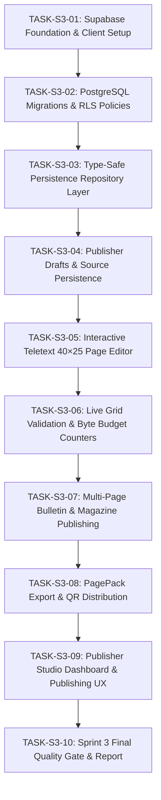

# PageCast — Sprint 3 Execution Plan
## Publisher Studio, Editing & Supabase Persistence

**Project:** PageCast — AI-Powered Low-Bandwidth Teletext Information Platform  
**Hackathon:** Kiroween 2026 (Resurrection Category)  
**Sprint:** Sprint 3 — Publisher Studio, Editing & Supabase Persistence  
**Date:** 2026-10-31  
**Status:** APPROVED FOR EXECUTION  

---

## 1. Sprint 3 Objectives & Roadmap

Sprint 3 bridges the gap between AI-generated Teletext drafts (Sprint 2) and published, persistent, verifiable bulletins:
1. **Database Architecture & Migrations:** Version-controlled PostgreSQL migrations defining profiles, sources, source sentences, pages, revisions, magazines, and publisher audit logs with Row Level Security (RLS).
2. **Type-Safe Persistence Layer:** Decoupled repository layer for drafts, published pages, and source provenance with both Supabase client and in-memory mock adapters for offline CI.
3. **Draft & Source Management:** Full lifecycle persistence for articles, extracted source sentences, and editable bulletin drafts.
4. **Interactive Teletext Page Editor:** In-browser 40×25 cell/row editor with color pickers (7 Teletext colors), character/grapheme boundary preservation, and keyboard navigation.
5. **Live Validation & Byte Budget Gauge:** Keystroke-level measurement against the 10,240-byte UTF-8 ceiling and 40×25 grid invariants.
6. **Multi-Page Bulletin & Magazine Publishing:** Magazine routing (Magazines 1–8), sub-page numbering (e.g. 101/1, 101/2, 101/3), sequential ordering, and catalogue synchronization.
7. **PagePack Export & QR Distribution:** Canonical JSON export/import and high-density QR code generation with payload integrity verification.
8. **Publisher Studio Integration:** Complete end-to-end publisher dashboard, editor, preview, and publication confirmation workflow.

---

## 2. Task Breakdown (S3-01 through S3-10)

---

### TASK-S3-01: Supabase Foundation & Client Setup

- **Requirements Covered:** FR-060, NFR-006, NFR-009, SEC-004
- **Dependencies:** Sprint 2 verified, `@supabase/supabase-js`, `qrcode`
- **Files Expected to Change:**
  - `package.json` (add `@supabase/supabase-js`, `qrcode`, `@types/qrcode`)
  - `src/server/database/client.ts` (typed server and client Supabase client factories)
  - `src/server/database/config.ts` (environment validation and secret isolation)
  - `tests/unit/database/client.test.ts`
  - `docs/TASK_S3_01_COMPLETION_REPORT.md`
- **Implementation Steps:**
  1. Install `@supabase/supabase-js`, `qrcode`, and `@types/qrcode`.
  2. Implement `src/server/database/config.ts` to validate Supabase URL, anon key, and service role key without throwing when unconfigured in local test mode.
  3. Implement `src/server/database/client.ts` providing typed `getSupabaseServerClient()` (uses service role key on server) and `getSupabaseBrowserClient()` (uses anon key in browser).
  4. Ensure client-side code cannot access service role key.
  5. Add unit tests for configuration parsing, client instantiation, and secret protection.
- **Acceptance Criteria:**
  - `pnpm typecheck` and `pnpm lint` pass.
  - Unit tests verify client creation and secret isolation.
  - No secret keys leaked to browser bundles.

---

### TASK-S3-02: PostgreSQL Migrations, Constraints & Row Level Security

- **Requirements Covered:** FR-060, FR-063, FR-065, FR-066, FR-067, NFR-009, SEC-004
- **Dependencies:** TASK-S3-01
- **Files Expected to Change:**
  - `supabase/migrations/20261031000001_initial_pagecast_schema.sql`
  - `supabase/migrations/20261031000002_row_level_security.sql`
  - `src/server/database/schema-contracts.ts` (TypeScript types matching SQL schema)
  - `tests/unit/database/migrations.test.ts` (SQL syntax, RLS verification, constraints)
  - `docs/TASK_S3_02_COMPLETION_REPORT.md`
- **Implementation Steps:**
  1. Author `20261031000001_initial_pagecast_schema.sql` defining:
     - `profiles` (`id`, `display_name`, `role`, `created_at`)
     - `sources` (`id`, `canonical_url`, `title`, `publisher`, `published_at`, `fetched_at`, `content_hash`, `language`)
     - `source_sentences` (`id`, `source_id`, `sentence_index`, `sentence_hash`, `sentence_text`)
     - `pages` (`id`, `page_number`, `slug`, `language`, `status`, `current_revision`, `created_by`, `created_at`, `updated_at`)
     - `page_revisions` (`id`, `page_id`, `revision`, `page_pack_json`, `payload_bytes`, `renderer_version`, `reviewed_by`, `reviewed_at`, `created_at`)
     - `page_sources` (`page_revision_id`, `source_id`)
     - `magazines` (`id`, `magazine_number`, `title`, `description`, `icon`)
     - `bulletin_pages` (`id`, `bulletin_id`, `page_number`, `subpage_index`, `page_revision_id`)
     - `publisher_audit_log` (`id`, `actor_id`, `action`, `resource_id`, `details`, `created_at`)
  2. Author `20261031000002_row_level_security.sql` enforcing:
     - Public read for active published pages and public catalogue.
     - Publishers can view/edit their own drafts.
     - Only publishers/admins can insert into `pages`, `page_revisions`, `publisher_audit_log`.
     - Anonymous users cannot read drafts or audit logs.
  3. Write migration integrity test validating table definitions, foreign keys, unique constraints (`page_number` for active pages), and RLS policy declarations.
- **Acceptance Criteria:**
  - Migrations are idempotent and syntactically valid PostgreSQL DDL.
  - Constraints guarantee page numbers are in `[100, 899]`.
  - RLS policies restrict anonymous users to published pages only.

---

### TASK-S3-03: Type-Safe Persistence Repository Layer

- **Requirements Covered:** FR-061, FR-065, NFR-009, NFR-013
- **Dependencies:** TASK-S3-02
- **Files Expected to Change:**
  - `src/server/database/repository.ts` (Repository interface: `DraftRepository`, `PageRepository`, `CatalogRepository`)
  - `src/server/database/memory-repository.ts` (In-memory implementation with full RLS simulation and constraint enforcement)
  - `src/server/database/supabase-repository.ts` (Supabase implementation)
  - `tests/unit/database/repository.test.ts`
  - `docs/TASK_S3_03_COMPLETION_REPORT.md`
- **Implementation Steps:**
  1. Define `IPersistenceRepository` containing methods:
     - `saveSource(source, sentences)`
     - `getSource(id)`
     - `createDraft(draft, userId)`
     - `updateDraft(draftId, updates, userId)`
     - `getDraft(draftId, userId)`
     - `listDrafts(userId)`
     - `publishPage(pageNumber, pack, userId)`
     - `getPageByNumber(pageNumber)`
     - `getCatalog()`
  2. Implement `MemoryPersistenceRepository` with strict constraints, simulated user contexts, and error handling.
  3. Implement `SupabasePersistenceRepository` leveraging Supabase client.
  4. Write comprehensive tests verifying CRUD operations, permission checks, duplicate page number rejection, and missing record handling.
- **Acceptance Criteria:**
  - Repository handles drafts, pages, sources, and catalogues without UI coupling.
  - Tests verify both success and failure cases with 100% pass rate.

---

### TASK-S3-04: Publisher Drafts and Saved Sources

- **Requirements Covered:** FR-020, FR-021, FR-027, FR-061, FR-062
- **Dependencies:** TASK-S3-03
- **Files Expected to Change:**
  - `src/app/api/v1/drafts/route.ts` (GET / POST)
  - `src/app/api/v1/drafts/[id]/route.ts` (GET / PATCH / DELETE)
  - `src/app/api/v1/sources/route.ts` (GET)
  - `tests/integration/draft-persistence.test.ts`
  - `docs/TASK_S3_04_COMPLETION_REPORT.md`
- **Implementation Steps:**
  1. Create App Router endpoints for saving and managing drafts:
     - `POST /api/v1/drafts`: Save new draft bulletin from ingested source.
     - `GET /api/v1/drafts`: List drafts for current publisher.
     - `GET /api/v1/drafts/[id]`: Retrieve single draft with source provenance.
     - `PATCH /api/v1/drafts/[id]`: Update draft title, summary, points, or target page number.
     - `DELETE /api/v1/drafts/[id]`: Remove draft.
  2. Wire automatic draft creation into the ingestion workflow so converted articles persist.
  3. Write integration tests for draft lifecycle and unauthorized access prevention.
- **Acceptance Criteria:**
  - Converted articles can be saved as private drafts.
  - Drafts are updated and retrieved reliably with full source metadata.

---

### TASK-S3-05: Interactive Teletext 40×25 Page Editor

- **Requirements Covered:** FR-001, FR-002, FR-009, FR-010, FR-062, UXR-008, UXR-009
- **Dependencies:** TASK-S3-04, Sprint 1 Teletext components
- **Files Expected to Change:**
  - `src/components/publisher/TeletextEditor.tsx` (40×25 grid interactive editor)
  - `src/components/publisher/ColorPalettePicker.tsx` (Teletext foreground/background color selector)
  - `src/components/publisher/EditorToolbar.tsx` (Row insert, clear, undo, language switch)
  - `tests/unit/components/teletext-editor.test.ts`
  - `docs/TASK_S3_05_COMPLETION_REPORT.md`
- **Implementation Steps:**
  1. Build `TeletextEditor` rendering a 40×25 editable grid canvas.
  2. Row 0: Locked header (formatted by layout engine).
  3. Rows 1–23: Editable text rows with cell-level and row-level navigation (Arrow keys, Enter, Backspace).
  4. Row 24: Navigation / Fastext row.
  5. Build `ColorPalettePicker` supporting all 7 Teletext colors (Red, Green, Yellow, Blue, Magenta, Cyan, White) and black background.
  6. Ensure Hindi Devanagari text input preserves combining characters and conjuncts without splitting.
  7. Add component tests verifying text input, color assignment, and row navigation.
- **Acceptance Criteria:**
  - Grid strictly enforces 40 columns and 25 rows during editing.
  - Hindi and English text can be typed and styled with Teletext colors.

---

### TASK-S3-06: Page-Level Editing, Validation and Live Counters

- **Requirements Covered:** FR-050, FR-051, FR-052, FR-053, FR-064, FR-065
- **Dependencies:** TASK-S3-05, `src/domain/byte-budget/measure.ts`
- **Files Expected to Change:**
  - `src/components/publisher/ByteBudgetMeter.tsx` (live UTF-8 byte counter and warning state)
  - `src/components/publisher/GridValidationBanner.tsx` (real-time error and warning display)
  - `src/app/api/v1/pages/validate/route.ts` (POST - server validation gate)
  - `tests/unit/components/byte-budget-meter.test.ts`
  - `tests/integration/page-validation.test.ts`
  - `docs/TASK_S3_06_COMPLETION_REPORT.md`
- **Implementation Steps:**
  1. Build `ByteBudgetMeter` showing:
     - `bytesUsed / 10,240 B`
     - Percentage progress bar (green < 80%, yellow 80–99%, red ≥ 100%)
     - Remaining bytes counter
  2. Implement live validation checking:
     - 40-column × 25-row geometry
     - Valid page number (100–899)
     - Source provenance presence
     - UTF-8 byte limit (≤ 10,240 bytes)
  3. Implement `POST /api/v1/pages/validate` for pre-publication server verification.
  4. Write tests verifying that over-budget pages (10,241 bytes) display error states and are rejected.
- **Acceptance Criteria:**
  - Byte counter updates live on every keystroke.
  - Over-budget or invalid grid states prevent publishing.

---

### TASK-S3-07: Multi-Page Bulletin & Magazine Publishing

- **Requirements Covered:** FR-003, FR-004, FR-063, FR-065, FR-067
- **Dependencies:** TASK-S3-06
- **Files Expected to Change:**
  - `src/domain/teletext/magazine.ts` (Magazine classifications, ranges 100–899, sub-page indexing)
  - `src/server/publishing/bulletin-publisher.ts` (Multi-page bulletin bundler & publication orchestrator)
  - `src/app/api/v1/pages/publish/route.ts` (POST - authenticated publish gate)
  - `tests/unit/domain/magazine.test.ts`
  - `tests/integration/multi-page-publishing.test.ts`
  - `docs/TASK_S3_07_COMPLETION_REPORT.md`
- **Implementation Steps:**
  1. Define magazine structure:
     - Magazine 1 (100–199): News & Index
     - Magazine 2 (200–299): Technology & Resilience
     - Magazine 3 (300–399): Weather & Environment
     - Magazine 4 (400–499): Sports
     - Magazine 5 (500–599): Culture & Entertainment
     - Magazine 6 (600–699): Markets & Finance
     - Magazine 7 (700–799): Public Notices
     - Magazine 8 (800–899): Emergency & System
  2. Implement multi-page bulletin support:
     - Main bulletin page (e.g. `101`) with subpages (`101/1`, `101/2`, `101/3`).
     - Subpage navigation in header and Fastext bar.
     - Each subpage is an independent, valid `PagePackV1` respecting the 10 KiB budget.
  3. Implement `POST /api/v1/pages/publish` with strict server gates:
     - Rejects unreviewed drafts (`reviewedAt` required).
     - Enforces duplicate page number prevention for active pages.
     - Enforces ≤ 10,240 bytes per subpage.
     - Creates immutable page revision and audit log.
  4. Write tests for multi-page publishing, sub-page navigation, and duplicate number rejection.
- **Acceptance Criteria:**
  - Multi-page bulletins can be assembled and published.
  - Server publish gate rejects invalid, unreviewed, or duplicate pages.

---

### TASK-S3-08: PagePack Export & QR Distribution

- **Requirements Covered:** FR-056, FR-080, FR-081, FR-085, NFR-004
- **Dependencies:** TASK-S3-07, `qrcode`
- **Files Expected to Change:**
  - `src/server/export/pack-export.ts` (Canonical JSON export & import validator)
  - `src/server/export/qr-distribution.ts` (Compact URL QR & payload distribution generator)
  - `src/components/publisher/ExportDialog.tsx` (Download JSON, copy share URL, display QR)
  - `src/app/api/v1/pages/[pageNumber]/pack/route.ts` (GET - download raw PagePack)
  - `tests/unit/export/qr-distribution.test.ts`
  - `tests/integration/export-import.test.ts`
  - `docs/TASK_S3_08_COMPLETION_REPORT.md`
- **Implementation Steps:**
  1. Implement canonical JSON export producing downloadable `.json` PagePacks.
  2. Implement `GET /api/v1/pages/[pageNumber]/pack` returning raw `application/json` PagePack.
  3. Implement QR code generator:
     - Tier 1 (P0): Generates high-contrast QR code encoding the public bulletin URL.
     - Tier 2 (P0): Validates payload size; flags when raw JSON exceeds standard single QR capacity (> 2,500 characters) and recommends URL QR or downloadable pack.
  4. Implement `ExportDialog` component for publisher and reader screens.
  5. Write tests verifying round-trip JSON export/import and QR generation safety (no script execution).
- **Acceptance Criteria:**
  - Exported JSON matches `PagePackV1` schema and passes re-import validation.
  - QR generation produces scannable codes without payload overflow.

---

### TASK-S3-09: Publisher Studio Integration & UX

- **Requirements Covered:** UXR-006, UXR-007, UXR-008, UXR-009, UXR-010, UXR-017
- **Dependencies:** TASK-S3-04, TASK-S3-05, TASK-S3-06, TASK-S3-07, TASK-S3-08
- **Files Expected to Change:**
  - `src/app/publisher/page.tsx` (Publisher Dashboard with draft list, published list, stats)
  - `src/app/publisher/editor/[id]/page.tsx` (Dedicated interactive editor page)
  - `src/components/publisher/PublisherHeader.tsx` (Navigation, status indicator)
  - `src/components/publisher/PublishModal.tsx` (Attribution checklist, final approval, publish trigger)
  - `tests/integration/publisher-workflow.test.ts`
  - `docs/TASK_S3_09_COMPLETION_REPORT.md`
- **Implementation Steps:**
  1. Build Publisher Dashboard:
     - Shows existing drafts, publication status, last edited time.
     - Quick actions: Ingest New Article, Edit Draft, Publish, View Live.
  2. Build `/publisher/editor/[id]` page:
     - Connects draft loading, interactive `TeletextEditor`, `ByteBudgetMeter`, CRT preview, and publish modal.
  3. Build `PublishModal`:
     - Displays source attribution link, reviewer confirmation checkbox, target page number selector, and final validation status.
  4. Ensure responsive behavior across mobile (360px) and desktop.
  5. Add end-to-end integration test simulating complete publisher flow.
- **Acceptance Criteria:**
  - Complete flow: Ingest → Save Draft → Edit 40×25 Grid → Validate → Publish → Export operates seamlessly.
  - UI provides clear feedback on success, errors, and validation states.

---

### TASK-S3-10: Full Integration Tests, Quality Gate & Completion Report

- **Requirements Covered:** All Sprint 3 requirements, NFR-001 through NFR-018
- **Dependencies:** All previous tasks
- **Files Expected to Change:**
  - `docs/SPRINT_3_COMPLETION_REPORT.md`
  - All regression test files
- **Implementation Steps:**
  1. Run complete quality suite: `pnpm quality:check` (env check, Prettier, ESLint, TypeScript, Vitest, Next.js build).
  2. Verify all database migrations, constraints, and RLS policies.
  3. Verify that zero secrets are leaked in client bundles.
  4. Document completed tasks, architecture decisions, test results, and Sprint 4 readiness in `docs/SPRINT_3_COMPLETION_REPORT.md`.
  5. Create dedicated commit for TASK-S3-10.
- **Acceptance Criteria:**
  - 100% quality check passes.
  - Zero warnings, zero errors.
  - Completion report complete.

---

## 3. Definition of Done for Sprint 3

1. All 10 tasks executed sequentially with independent verification.
2. PostgreSQL migrations and RLS policies documented and tested.
3. Type-safe persistence repository layer functional with zero UI coupling.
4. Interactive 40×25 Teletext editor supports text editing, 7 Teletext colors, and Hindi Devanagari.
5. Live byte budget counter accurately measures UTF-8 bytes against the 10,240-byte ceiling.
6. Multi-page bulletins and magazines (100–899) supported and validated.
7. PagePack JSON export and QR distribution tested.
8. Publisher Studio dashboard and editor routes functional.
9. `pnpm quality:check` passes with 100% success rate.
10. `docs/SPRINT_3_COMPLETION_REPORT.md` created.
