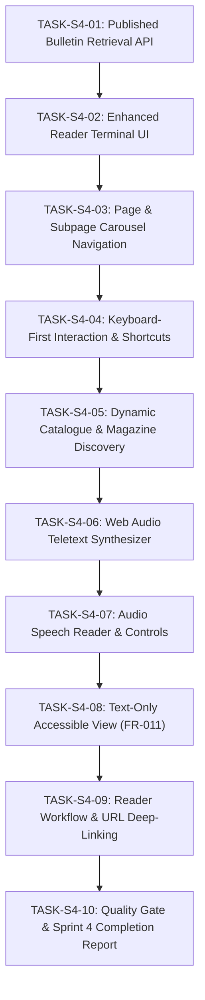

# PageCast — Sprint 4 Execution Plan
## Reader Experience, Navigation & Audio Synthesizer

**Project:** PageCast — AI-Powered Low-Bandwidth Teletext Information Platform  
**Hackathon:** Kiroween 2026 (Resurrection Category)  
**Sprint:** Sprint 4 — Reader Experience, Navigation & Audio Synthesizer  
**Date:** 2026-10-31  
**Status:** APPROVED FOR SEQUENTIAL EXECUTION  

---

## 1. Sprint 4 Objectives & Scope

Sprint 4 delivers the primary consumer-facing experience of PageCast:
1. **Published Bulletin Retrieval & Access Control:** Public data-access endpoint (`GET /api/v1/pages/[pageNumber]`) retrieving live published `PagePackV1` payloads while strictly isolating unpublished drafts.
2. **Authentic Teletext Terminal:** Refined 40×25 CRT reader interface with high-contrast palette, CRT scanlines, phosphor glow, loading states, and not-found screens.
3. **Carousel & Subpage Navigation:** Continuous multi-page navigation (`101/1`, `101/2`, `101/3`), auto-rotation timer with manual pause/resume, and circular magazine boundary jumping.
4. **Keyboard-First Interaction:** Standard Teletext 3-digit buffer dialing (`0`-`9`), Arrow navigation, Fastext shortcuts (`R`, `G`, `Y`, `C`), `Home` for P100, and shortcut cheat-sheet without trapping active form inputs.
5. **Broadcast Catalogue & Discovery:** `GET /api/v1/catalog` endpoint and responsive catalogue page grouping bulletins across all 8 Teletext magazines with search and language filters.
6. **Web Audio Synthesizer:** Isolated Web Audio API engine providing retro Teletext carrier hum, page dial chirps, and navigation tones, strictly requiring user gesture before playback.
7. **Audio Speech Reader:** Assistive Web Speech API engine narrating bulletin headlines, key points, and source attribution in English and Hindi with play/pause/rate controls.
8. **Text-Only Accessible Alternative (FR-011):** Clean semantic HTML view (`role="article"`) with structured reading order, skipping decorative 40×25 spans for assistive tech.
9. **Reader Journey & URL Synchronization:** Dynamic route `/pages/[pageNumber]` and shallow URL synchronization `/terminal?page=...` with full browser history support.
10. **Full Quality Gate:** 100% verification across `env:check`, `format:check`, `lint`, `typecheck`, automated Vitest suites, and Next.js production build.

---

## 2. Task Breakdown (S4-01 through S4-10)

---

### TASK-S4-01: Published Bulletin Retrieval API

- **Requirements Covered:** FR-003, FR-006, FR-023, FR-060, SEC-004
- **Dependencies:** Sprint 3 persistence repository
- **Files Expected to Change:**
  - `src/app/api/v1/pages/[pageNumber]/route.ts` (GET public page fetcher)
  - `src/server/reader/reader-client.ts` (Server/client data fetcher with cache & fallback)
  - `tests/integration/reader-api.test.ts`
  - `docs/TASK_S4_01_COMPLETION_REPORT.md`
- **Implementation Steps:**
  1. Implement `GET /api/v1/pages/[pageNumber]`:
     - Validates `pageNumber` parameter [100..899].
     - Queries `repository.getPageByNumber(num)`.
     - Ensures `page.status === "published"`. If status is "draft", returns 404 (draft isolation).
     - Returns `{ success: true, page: PageRow, pack: PagePackV1, subPages: number }`.
     - Sets HTTP caching headers (`Cache-Control: public, max-age=60, s-maxage=300`).
  2. Implement client reader helper with graceful offline/seed fallback.
  3. Write integration tests verifying published page retrieval, draft privacy, and not-found handling.
- **Acceptance Criteria:**
  - Published pages are accessible anonymously; draft pages are strictly hidden (404).

---

### TASK-S4-02: Enhanced Reader Terminal UI

- **Requirements Covered:** FR-001, FR-002, FR-009, FR-012, UXR-001, UXR-002
- **Dependencies:** TASK-S4-01, `TeletextGrid`
- **Files Expected to Change:**
  - `src/components/teletext/ReaderTerminal.tsx` (Refined production terminal)
  - `src/components/teletext/TerminalHeader.tsx` (Status bar, magazine tag, display toggles)
  - `src/components/teletext/TerminalNotFound.tsx` (Authentic Teletext 40×25 error screen)
  - `tests/unit/components/reader-terminal.test.ts`
  - `docs/TASK_S4_02_COMPLETION_REPORT.md`
- **Implementation Steps:**
  1. Build `TerminalHeader` showing live connection badge, active magazine name, time, and display toggles (scanlines, CRT glow).
  2. Build `TerminalNotFound` generating an authentic 40×25 CRT error display advising valid page numbers.
  3. Build `ReaderTerminal` integrating live loading skeletons, error states, and responsive scaling down to 360px mobile.
  4. Write unit tests for terminal states (loading, error, loaded).
- **Acceptance Criteria:**
  - Terminal renders 40×25 grid stably without layout shifts or text overflow on mobile and desktop.

---

### TASK-S4-03: Page & Subpage Carousel Navigation

- **Requirements Covered:** FR-003, FR-004, FR-063
- **Dependencies:** TASK-S4-02, `src/domain/teletext/magazine.ts`
- **Files Expected to Change:**
  - `src/components/teletext/SubPageCarousel.tsx` (Subpage stepping, indicators, timer)
  - `src/components/teletext/TeletextDialer.tsx` (Updated with magazine bounds)
  - `tests/unit/components/subpage-carousel.test.ts`
  - `docs/TASK_S4_03_COMPLETION_REPORT.md`
- **Implementation Steps:**
  1. Implement `SubPageCarousel` controls:
     - Shows current subpage index `1/3` (or `01/03`).
     - Previous / Next subpage buttons.
     - Auto-rotation toggle (cycles every 12 seconds like standard Teletext carousels) with pause/play button.
  2. Ensure dialer supports circular navigation across catalogue items.
  3. Write tests for subpage stepping, timer pausing, and carousel wrap-around.
- **Acceptance Criteria:**
  - Multi-page bulletins cycle subpages cleanly without memory leaks or timing glitches.

---

### TASK-S4-04: Keyboard-First Interaction & Accessible Shortcuts

- **Requirements Covered:** FR-005, UXR-005, ACC-001
- **Dependencies:** TASK-S4-03
- **Files Expected to Change:**
  - `src/hooks/useTeletextKeyboard.ts` (Isolated keyboard navigation hook)
  - `src/components/teletext/KeyboardShortcutsModal.tsx` (Help overlay)
  - `tests/unit/hooks/keyboard-navigation.test.ts`
  - `docs/TASK_S4_04_COMPLETION_REPORT.md`
- **Implementation Steps:**
  1. Implement `useTeletextKeyboard`:
     - Digits `0-9`: Appends to a 3-digit buffer with timeout (e.g. typing `2`, `0`, `1` navigates to P201).
     - Arrow Up / Page Up: Next page.
     - Arrow Down / Page Down: Previous page.
     - Arrow Left: Previous subpage.
     - Arrow Right: Next subpage.
     - Key `R`: Red Fastext link.
     - Key `G`: Green Fastext link.
     - Key `Y`: Yellow Fastext link.
     - Key `C` or `B`: Cyan/Blue Fastext link.
     - Key `Home`: Jump to P100 (Main Index).
     - Key `?` or `H`: Toggle shortcuts help modal.
     - Ignores keydown if target is `input`, `textarea`, or `select`.
  2. Implement `KeyboardShortcutsModal` presenting a clean Teletext-styled legend.
  3. Write unit tests for buffer dialing, arrow keys, and input isolation.
- **Acceptance Criteria:**
  - Complete terminal operation possible with keyboard alone without focus trapping.

---

### TASK-S4-05: Dynamic Catalogue & Magazine Discovery

- **Requirements Covered:** FR-003, FR-004, FR-060
- **Dependencies:** TASK-S4-01, `src/domain/teletext/magazine.ts`
- **Files Expected to Change:**
  - `src/app/api/v1/catalog/route.ts` (GET public catalog endpoint)
  - `src/app/catalogue/page.tsx` (Updated dynamic magazine catalogue)
  - `tests/integration/catalogue-api.test.ts`
  - `docs/TASK_S4_05_COMPLETION_REPORT.md`
- **Implementation Steps:**
  1. Implement `GET /api/v1/catalog`:
     - Queries `repository.getCatalog()`.
     - Queries `repository.getMagazines()`.
     - Returns grouped catalog with magazine descriptions and active page counts.
  2. Overhaul `src/app/catalogue/page.tsx`:
     - Groups bulletins under all 8 Teletext magazines (Magazines 1 to 8).
     - Provides search filter and language selector (English / Hindi).
     - Shows page number, title, subpage count, and deep-link to terminal.
  3. Write integration tests for catalogue API and grouping.
- **Acceptance Criteria:**
  - All published bulletins appear in their correct magazine section; empty magazines show helpful guidance.

---

### TASK-S4-06: Web Audio Teletext Synthesizer

- **Requirements Covered:** NFR-004, UXR-014
- **Dependencies:** Web Audio API standards
- **Files Expected to Change:**
  - `src/lib/audio/teletext-synthesizer.ts` (Isolated Web Audio synthesizer engine)
  - `tests/unit/audio/synthesizer.test.ts`
  - `docs/TASK_S4_06_COMPLETION_REPORT.md`
- **Implementation Steps:**
  1. Implement `TeletextSynthesizer` class:
     - `initialize()`: Creates `AudioContext` only after explicit user interaction.
     - `playTuningChirp(pageNumber)`: Generates authentic retro Teletext modem/carrier frequency chirp.
     - `playNavigationTick()`: Subtle high-frequency blip on row/page selection.
     - `playFastextTone(color)`: Harmonized chord corresponding to Red, Green, Yellow, Cyan buttons.
     - `setMuted(muted: boolean)` / `setVolume(volume: number)` (0.0 to 1.0).
     - `dispose()`: Disconnects nodes and closes `AudioContext`.
  2. Safeguards:
     - Never auto-plays on page load.
     - Gracefully handles unsupported environments (Node.js/SSR/disabled audio).
     - Reuses single `AudioContext` instance without node leakage.
  3. Write unit tests with mock `AudioContext`.
- **Acceptance Criteria:**
  - Audio plays only after explicit click; zero CPU/audio usage when muted or closed.

---

### TASK-S4-07: Audio Speech Reader & Controls

- **Requirements Covered:** FR-011, UXR-014
- **Dependencies:** TASK-S4-06, Web Speech API standards
- **Files Expected to Change:**
  - `src/lib/audio/speech-reader.ts` (Web Speech API narration engine)
  - `src/components/teletext/AudioControls.tsx` (Mute/Volume/Speech UI bar)
  - `tests/unit/audio/speech-reader.test.ts`
  - `docs/TASK_S4_07_COMPLETION_REPORT.md`
- **Implementation Steps:**
  1. Implement `BulletinSpeechReader`:
     - Extracts title, headline, key points, and source attribution from `PagePackV1` or `TeletextPage`.
     - Supports English (`en-US`/`en-GB`) and Hindi (`hi-IN`) synthesis.
     - Play, pause, resume, and stop controls.
     - Plays subtle chime via `TeletextSynthesizer` when starting playback.
  2. Build `AudioControls` UI toolbar:
     - Retro speaker icon toggle (Muted / Sound On).
     - Volume slider.
     - "Read Bulletin" narration button with playback state indicators.
  3. Write unit tests for speech parsing, playback lifecycle, and error handling.
- **Acceptance Criteria:**
  - Speech reader sequentially narrates bulletin content with complete user stop/pause control.

---

### TASK-S4-08: Text-Only Accessible View (FR-011)

- **Requirements Covered:** FR-011, ACC-001, ACC-002
- **Dependencies:** TASK-S4-02
- **Files Expected to Change:**
  - `src/components/teletext/AccessibleTextView.tsx` (Semantic article view)
  - `tests/unit/components/accessible-text-view.test.ts`
  - `docs/TASK_S4_08_COMPLETION_REPORT.md`
- **Implementation Steps:**
  1. Implement `AccessibleTextView`:
     - Renders semantic HTML: `<article>`, `<h1>`, `<h2>`, `
`, `<ul>`, `<li>`, `<footer>`.
     - Includes source provenance link with `rel="noopener noreferrer"`.
     - Includes Fastext links as accessible keyboard-navigable buttons.
     - Offers High-Contrast (Black on White / White on Black) and font size scaling.
  2. Provide easy toggle button between "CRT Mode" and "Accessible Text Mode".
  3. Write unit tests ensuring screen-reader accessibility and semantic heading hierarchy.
- **Acceptance Criteria:**
  - Automated axe-core/accessibility assertions pass with zero critical violations.

---

### TASK-S4-09: Reader Workflow & URL Deep-Linking

- **Requirements Covered:** FR-003, FR-006, FR-080, FR-081
- **Dependencies:** TASK-S4-01 through TASK-S4-08
- **Files Expected to Change:**
  - `src/app/pages/[pageNumber]/page.tsx` (Refined dynamic server-rendered page)
  - `src/app/terminal/page.tsx` (Dedicated full-screen reader terminal)
  - `src/components/teletext/WebTerminal.tsx` (Updated integration)
  - `tests/integration/reader-workflow.test.ts`
  - `docs/TASK_S4_09_COMPLETION_REPORT.md`
- **Implementation Steps:**
  1. Wire `WebTerminal` to live data:
     - Reads `pageNumber` from props or URL search params.
     - Synchronizes URL shallowly (`/terminal?page=201`) without full-page reload.
     - Integrates `ExportDialog` (QR code generation & JSON pack download).
     - Connects `AudioControls`, `SubPageCarousel`, `AccessibleTextView`, and `KeyboardShortcutsModal`.
  2. Implement `/pages/[pageNumber]` SSR route prefetching from repository.
  3. Write end-to-end integration tests simulating complete reader journey.
- **Acceptance Criteria:**
  - Reader loads live published content, dials pages, cycles subpages, toggles audio, and shares via QR.

---

### TASK-S4-10: Quality Gate & Sprint 4 Completion Report

- **Requirements Covered:** All Sprint 4 requirements, NFR-001 through NFR-018
- **Dependencies:** All previous tasks
- **Files Expected to Change:**
  - `docs/SPRINT_4_COMPLETION_REPORT.md`
- **Implementation Steps:**
  1. Run `pnpm quality:check` (env check, Prettier, ESLint, TypeScript, Vitest, Next.js production build).
  2. Verify that 100% of tests pass and zero TypeScript errors exist.
  3. Compile detailed Sprint 4 completion report.
  4. Final commit for Sprint 4.
- **Acceptance Criteria:**
  - All automated quality gates pass.
