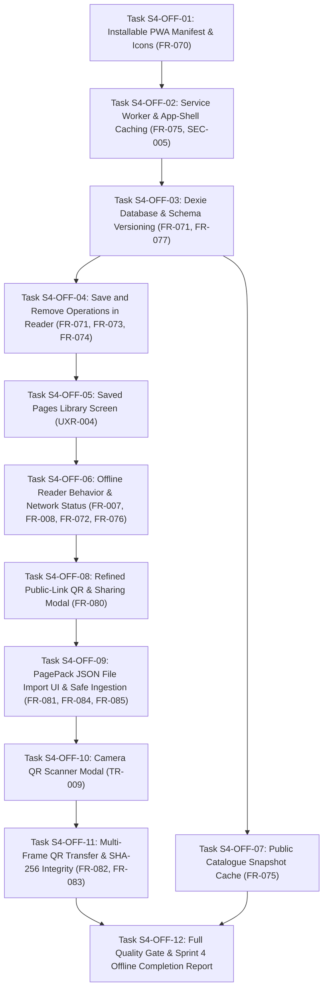

# PageCast Sprint 4 Gap Execution Plan: Offline PWA, Saved Pages and Sharing

**Kiroween 2026 — Resurrection Category**  
**Role:** Principal Software Architect, PWA Engineer, Offline-First Application Engineer, Security Engineer, QA Automation Architect  
**Repository Root:** `c:\Users\Atul2\OneDrive\Desktop\KiroHackethon\pagecast`  
**Date:** October 31, 2026  
**Status:** **APPROVED FOR EXECUTION**

---

## 1. Master Task Dependency Graph

---

## 2. Granular Task Specifications

### Task S4-OFF-01: Installable PWA Manifest & Icons (FR-070)
- **Goal:** Implement Next.js 16 native App Router Web App Manifest and generate compliant Teletext brand icons.
- **Files:**
  - `src/app/manifest.ts` (Next.js App Router metadata manifest)
  - `public/icons/icon-192x192.png`, `public/icons/icon-512x512.png`, `public/icons/icon-maskable-512x512.png`, `public/favicon.ico`
  - `src/app/layout.tsx` (PWA meta tags, theme color `#000000`, viewport)
  - `src/hooks/usePwaInstallPrompt.ts` (Deferred prompt hook)
  - `tests/unit/pwa/manifest.test.ts`
- **Acceptance:** Valid manifest served at `/manifest.webmanifest` with standalone display mode and valid icons.

### Task S4-OFF-02: Service Worker & App-Shell Caching (FR-075, SEC-005)
- **Goal:** Implement clean service worker caching static app shell assets and strictly excluding sensitive data.
- **Files:**
  - `public/sw.js` (Cache-first for static assets, network-first for pages, strictly bypasses drafts/secrets/API)
  - `src/lib/pwa/sw-register.ts` (Safe client-side service worker registration helper)
  - `tests/unit/pwa/service-worker.test.ts`
- **Acceptance:** Zero auth, session, or publisher draft requests are stored in the service worker cache.

### Task S4-OFF-03: Dexie Database & Schema Versioning (FR-071, FR-077)
- **Goal:** Create a versioned IndexedDB database using Dexie.js for client-side persistence.
- **Files:**
  - `package.json` (Add `dexie`)
  - `src/lib/storage/dexie-db.ts` (`PageCastDexieDb` schema version 1)
  - `tests/unit/storage/dexie-db.test.ts`
- **Acceptance:** IndexedDB store `saved_pages` stores full validated `PagePackV1` records with schema migrations.

### Task S4-OFF-04: Save and Remove Operations in Reader (FR-071, FR-073, FR-074)
- **Goal:** Wire save/remove actions into the reader terminal with real-time UI state.
- **Files:**
  - `src/lib/storage/saved-pages.ts` (`savePageLocally`, `removeSavedPage`, `isPageSaved`)
  - `src/components/teletext/WebTerminal.tsx` (Save/Saved button in top utility bar)
  - `tests/unit/storage/saved-pages.test.ts`
- **Acceptance:** Clicking "Save Page" saves the active PagePack in IndexedDB and updates button state immediately.

### Task S4-OFF-05: Saved Pages Library Screen (UXR-004)
- **Goal:** Build a dedicated `/saved` page for managing the local offline collection.
- **Files:**
  - `src/app/saved/page.tsx`
  - `tests/integration/saved-pages-ui.test.ts`
- **Acceptance:** Lists saved pages with magazine badges, title, save date, "Read Offline" link, and "Remove" button.

### Task S4-OFF-06: Offline Reader Behavior & Network Status (FR-007, FR-008, FR-072, FR-076)
- **Goal:** Enable genuine network-independent reading for saved pages and true offline status display.
- **Files:**
  - `src/hooks/useOnlineStatus.ts`
  - `src/lib/reader/reader-client.ts` (Fetch from IndexedDB when offline)
  - `src/components/teletext/TerminalOfflineUnavailable.tsx` (40×25 missing offline state)
  - `tests/integration/offline-reading.test.ts`
- **Acceptance:** Saved pages load instantaneously when offline; unsaved pages show a clear offline explanation without false success.

### Task S4-OFF-07: Public Catalogue Snapshot Cache (FR-075)
- **Goal:** Cache a small public catalogue snapshot in Dexie for offline browsing.
- **Files:**
  - `src/lib/storage/catalogue-snapshot.ts`
  - `src/app/catalogue/page.tsx` (Fallback to snapshot when offline)
  - `tests/unit/storage/catalogue-snapshot.test.ts`
- **Acceptance:** Offline catalogue renders cached magazines with a clear "Offline Snapshot" badge.

### Task S4-OFF-08: Refined Public-Link QR & Sharing Modal (FR-080)
- **Goal:** Enhance `ExportDialog.tsx` with high-contrast QR display, copy link, and download controls.
- **Files:**
  - `src/components/publisher/ExportDialog.tsx`
  - `tests/unit/export/public-qr.test.ts`
- **Acceptance:** Scannable public-link QR generated in compliance with FR-080.

### Task S4-OFF-09: PagePack JSON File Import UI & Safe Ingestion (FR-081, FR-084, FR-085)
- **Goal:** Build client-side JSON file import dialog with strict validation against 10 KiB ceiling and schema.
- **Files:**
  - `src/components/teletext/ImportDialog.tsx`
  - `src/components/teletext/WebTerminal.tsx` (Import button in utility bar)
  - `tests/unit/components/import-dialog.test.ts`
- **Acceptance:** Valid PagePack JSON files import into Dexie; invalid, oversized, or malicious files are safely rejected.

### Task S4-OFF-10: Camera QR Scanner Modal (TR-009)
- **Goal:** Implement camera scanning for QR codes with optical detection, validation, and safe import.
- **Files:**
  - `src/components/teletext/QrScannerModal.tsx`
  - `tests/unit/components/qr-scanner.test.ts`
- **Acceptance:** Camera scanner decodes public URLs or PagePack transfer packets with permission handling.

### Task S4-OFF-11: Multi-Frame QR Transfer & SHA-256 Integrity (FR-082, FR-083)
- **Goal:** Implement animated multi-frame QR packet encoding, reassembly, and Web Crypto SHA-256 verification.
- **Files:**
  - `src/lib/qr/multi-frame-codec.ts`
  - `tests/unit/qr/multi-frame-codec.test.ts`
- **Acceptance:** Chunks reconstruct successfully into original PagePack; altered packets fail SHA-256 check.

### Task S4-OFF-12: Full Quality Gate & Sprint 4 Offline Completion Report
- **Goal:** Run `pnpm quality:check`, compile final reports, and verify all P0/P1 criteria.
- **Files:**
  - `docs/SPRINT_4_OFFLINE_COMPLETION_REPORT.md`
- **Acceptance:** 100% quality gate pass.
