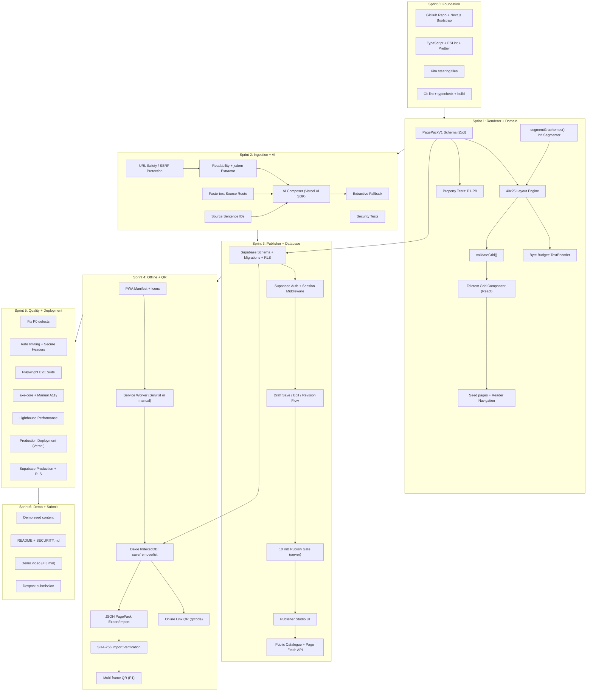

# PageCast — Sprint Plan

**Phase:** 1 — Discovery & Requirement Analysis  
**Date:** 30 October 2026  
**Deadline:** 4 December 2026, 2:00 PM PT (5 December 2026, 3:30 AM IST)  
**Developer:** Solo

---

## Dependency Map

---

## Sprint 0 — Foundation and Architecture

**Dates:** 30–31 October 2026 (2 days)  
**Goal:** Establish the project foundation before any feature work begins.

### Objective
Create a clean GitHub repository, bootstrap the Next.js application with the full toolchain, and set up Kiro configuration so that Sprint 1 can start with a working CI and a defined project structure.

### Tasks

**Planning (Day 1 — 30 October)**
- [x] Read and analyze complete specification (this Phase 1 document)
- [ ] Confirm Resurrection as the target category
- [ ] Read the Kiroween official rules and submission checklist
- [ ] Define target user journeys (already done in spec §4)
- [ ] Finalize P0/P1/P2 scope (captured in requirements traceability)
- [ ] Create low-fidelity wireframes for reader, publisher and composer screens
- [ ] Define teletext palette tokens and typography decisions
- [ ] Create data-flow and threat model for URL ingestion (captured in architecture doc)

**Implementation (Days 1–2 — 30–31 October)**
- [ ] Create GitHub public repository
- [ ] Bootstrap Next.js 16.x Active LTS + TypeScript (strict) + Tailwind CSS 4.x
- [ ] Add ESLint + Prettier configuration
- [ ] Add `tsconfig.json` with `strict: true`, path aliases (`@/`)
- [ ] Create initial project directory structure matching spec §16
- [ ] Add `.env.example` with all variables from spec §17
- [ ] Add `.gitignore` (include `.env`, never `.env.example`)
- [ ] Add `LICENSE` (MIT or Apache 2.0)
- [ ] Create initial `.kiro/steering/` files (product, architecture, coding-standards, security, teletext-domain, testing)
- [ ] Configure GitHub Actions CI: lint + typecheck + build

**Testing (Days 1–2)**
- [ ] Verify clean `pnpm install` and `pnpm build` on Windows 11
- [ ] Verify CI runs from a clean checkout
- [ ] Verify TypeScript compiler finds zero errors on initial scaffold

### Dependencies
- None (greenfield start)

### Expected Deliverables
- Public GitHub repository with initial commit
- Clean Next.js 16 app with TypeScript, Tailwind 4, ESLint, Prettier
- `.kiro/steering/` directory with 6 steering files
- CI passing on main branch
- `.env.example` with all variable placeholders
- `LICENSE` file

### Acceptance Criteria
- `pnpm lint` passes
- `pnpm tsc --noEmit` passes
- `pnpm build` succeeds
- CI pipeline runs and is green
- No secrets in any committed file

### Definition of Done
- [ ] CI green on main
- [ ] TypeScript strict mode active
- [ ] All 6 steering files present in `.kiro/steering/`
- [ ] `.env.example` matches spec §17
- [ ] `LICENSE` visible in GitHub

### Potential Blockers
- Windows 11 path handling with pnpm
- Tailwind CSS 4.x PostCSS plugin configuration with Next.js 16

---

## Sprint 1 — Teletext Design System and Deterministic Renderer

**Dates:** 1–6 November 2026 (6 days)  
**Goal:** Build the visual and logical heart of PageCast before adding AI or database dependencies.

### Objective
Implement the pure TypeScript domain layer (PagePack schema, grapheme segmenter, layout engine, byte budget, grid validator) and the React Teletext grid component. Add seed pages and basic reader navigation. The renderer must be testable without React.

### Tasks

**Design (Days 1–2)**
- [ ] Finalize header/body/footer grid treatment (row allocation)
- [ ] Design page-number navigation UI (monospace input, prev/next buttons)
- [ ] Design English and Hindi test page content (at least 2 English, 2 Hindi, 1 mixed)
- [ ] Define empty, loading, error and offline state designs
- [ ] Define colour palette as Tailwind CSS custom tokens

**Implementation (Days 1–5)**
- [ ] Create `src/domain/page-pack/schema.ts` — `PagePackV1` TypeScript type + Zod schema
- [ ] Create `src/domain/layout-engine/graphemes.ts` — `segmentGraphemes()` using `Intl.Segmenter`
- [ ] Create `src/domain/layout-engine/layout.ts` — 40×25 layout algorithm with word-boundary wrapping
- [ ] Create `src/domain/byte-budget/measure.ts` — `measurePagePack()` with `TextEncoder`
- [ ] Create `src/domain/validation/validate-grid.ts` — `validateGrid()` (25 rows × 40 cols assertion)
- [ ] Create `src/domain/validation/page-number.ts` — 100–899 range + uniqueness check
- [ ] Create `src/components/teletext/TeletextGrid.tsx` — responsive 40×25 grid component
- [ ] Create `src/components/teletext/TeletextRow.tsx` and `TeletextCell.tsx`
- [ ] Apply Teletext colour palette via Tailwind tokens
- [ ] Create `src/components/teletext/AccessibleAlternative.tsx` — screen-reader text representation
- [ ] Create `src/app/(reader)/page.tsx` — landing / reader home with featured pages
- [ ] Create `src/app/(reader)/pages/[pageNumber]/page.tsx` — single page view
- [ ] Create `src/app/(reader)/catalogue/page.tsx` — catalogue list
- [ ] Add 5+ seeded page fixtures in `tests/fixtures/` and seed script
- [ ] Add page-number navigation (prev/next) and direct input
- [ ] Add Noto Sans Mono + Noto Sans Devanagari font loading

**Testing (Days 3–6)**
- [ ] `tests/unit/domain/schema.test.ts` — PagePackV1 schema: valid/invalid fixtures
- [ ] `tests/unit/domain/graphemes.test.ts` — Devanagari conjuncts, matras, mixed Latin/Hindi
- [ ] `tests/unit/domain/layout.test.ts` — English word wrapping, overflow handling
- [ ] `tests/unit/domain/byte-budget.test.ts` — UTF-8 vs string length comparison with Hindi
- [ ] `tests/unit/domain/validate-grid.test.ts` — 25-row pass, 24/26-row fail
- [ ] `tests/property/grid.property.test.ts` — P1–P8 property tests using fast-check
- [ ] Playwright responsive tests at 360, 390, 768, 1366 px
- [ ] Manual keyboard navigation and screen-reader smoke check
- [ ] Create KIRO spec: `.kiro/specs/02-teletext-renderer/`
- [ ] Create KIRO hooks: `renderer-tests.json`, `page-budget.json`

### Dependencies
- Sprint 0 complete (Next.js app running, CI active)

### Expected Deliverables
- `src/domain/` pure TypeScript module — fully tested
- `TeletextGrid` React component
- Reader can browse at least 5 seeded pages
- All 8 property test invariants (P1–P8) passing
- Hindi test fixtures rendering without grapheme splits

### Acceptance Criteria
- `validateGrid(page)` returns true only for exactly 25-row × 40-column layouts
- Hindi test page renders without split grapheme clusters (verified by property test P3)
- Same input + renderer version produces same grid (P4 passes)
- Byte counter uses TextEncoder, not string length (verified by unit test)
- Domain tests pass without importing React or Next.js

### Definition of Done
- [ ] All unit and property tests pass in CI
- [ ] Reader displays seed pages in browser
- [ ] Hindi fixture page has no split grapheme clusters
- [ ] Renderer logic has zero React/Next.js imports in domain layer
- [ ] KIRO specs and hooks created for this feature

### Potential Blockers
- `Intl.Segmenter` behavior differences between Node.js and browser environments
- Tailwind monospace font configuration for exact character-width alignment
- Hindi test content requiring domain expertise for correct Devanagari

---

## Sprint 2 — Article Ingestion and AI Bulletin Composer

**Dates:** 7–12 November 2026 (6 days)  
**Goal:** Transform a supported article URL or pasted text into a reviewed AI-generated structured draft.

### Objective
Implement the server-side article ingestion pipeline with SSRF protection, integrate Mozilla Readability for content extraction, connect the Vercel AI SDK with Google Gemini for structured bulletin generation, and build the publisher-facing extraction preview and composer UI.

> [!CAUTION]
> SSRF protection (RISK-S01) must be fully implemented and tested **before** any URL is fetched from user input. Do not ship a working URL fetch without complete IP block-listing.

### Tasks

**Design (Days 1–2)**
- [ ] Design Source Import screen (URL input, progress, extraction preview)
- [ ] Design AI generation progress and provider-error states
- [ ] Design source/evidence review interface
- [ ] Design English/Hindi language selection

**Implementation (Days 1–5)**
- [ ] Create `src/server/security/url-safety.ts` — full SSRF protection:
  - Scheme check (http/https only)
  - No credentials, fragments or non-standard ports
  - DNS resolution + private/loopback/link-local/reserved IP block list
  - Maximum 3 redirects; re-check DNS on each redirect
  - 8-second timeout; 2 MiB response size limit
  - Content-type validation (HTML or plain text only)
  - No forwarding of cookies or auth headers
- [ ] Create `src/server/ingestion/extractor.ts` — Readability + jsdom (scripts disabled)
- [ ] Create `src/server/ingestion/sentence-ids.ts` — stable sentence ID generation
- [ ] Create `/api/v1/sources/extract` route handler
- [ ] Create `/api/v1/sources/from-text` route handler
- [ ] Create Zod schema for `BulletinDraft` (AI output schema)
- [ ] Create `src/server/ai/composer.ts` — Vercel AI SDK structured generation
- [ ] Implement system prompt with source-data isolation and anti-injection rules
- [ ] Implement source sentence ID validation in AI output
- [ ] Create `src/server/ai/extractive-fallback.ts` — deterministic summarizer
- [ ] Create `/api/v1/bulletins/compose` route handler
- [ ] Create `src/components/publisher/SourceImport.tsx`
- [ ] Create `src/components/publisher/BulletinComposer.tsx`
- [ ] Store generation metadata (provider, model, prompt version, timestamp)

**Testing (Days 3–6)**
- [ ] `tests/security/url-safety.test.ts`:
  - Invalid schemes (ftp, file, javascript)
  - Loopback (127.x.x.x, ::1)
  - Private ranges (10.x, 172.16-31.x, 192.168.x)
  - Link-local (169.254.x, fe80::)
  - Cloud metadata (169.254.169.254)
  - Redirect to private address
  - Oversized response (> 2 MiB)
  - Slow response (> 8 s) — use mock
  - Non-HTML content type
- [ ] `tests/unit/ai/composer.test.ts` — structured output validation, sentence ID checks
- [ ] `tests/unit/ai/extractive-fallback.test.ts`
- [ ] `tests/integration/ingestion-pipeline.test.ts` — URL → source record → AI draft
- [ ] Test prompt injection text in article content (injected instructions ignored)
- [ ] Test Hindi output layout fixture
- [ ] Create KIRO spec: `.kiro/specs/03-source-ingestion-ai/`

### Dependencies
- Sprint 1 complete (domain layer functional)
- Vercel AI SDK installed; Google Gemini API key available
- Mozilla Readability + jsdom installed

### Expected Deliverables
- SSRF-protected URL ingestion endpoint with full security test suite
- Article extraction producing source record with sentence IDs
- AI composer generating structured BulletinDraft with Zod validation
- Extractive fallback working without AI provider
- Publisher can see extracted content before AI composition
- No AI-generated content published automatically

### Acceptance Criteria
- All 9 URL safety security tests pass
- Prompt injection in article content does not change AI output schema
- Generated draft includes at least one sentence ID per factual point
- Extractive fallback produces a valid (though lower quality) draft without API calls

### Definition of Done
- [ ] Security tests pass in CI
- [ ] AI draft validated by Zod before leaving the server
- [ ] Human review UI shows extraction preview before AI generation
- [ ] Extractive fallback demonstrably works with AI provider mocked as unavailable
- [ ] KIRO spec created for this feature

### Potential Blockers
- DNS resolution in Node.js for SSRF protection requires specific implementation
- Readability extraction quality varies by target site; demo URLs must be pre-tested
- Gemini API rate limits during heavy testing

---

## Sprint 3 — Publisher Studio, PagePack Budget and Publishing

**Dates:** 13–18 November 2026 (6 days)  
**Goal:** Turn AI drafts into controlled public pages with authentication, a byte-budget gate and a proper publisher workflow.

### Objective
Set up Supabase Postgres with schema migrations and RLS policies. Implement publisher authentication. Build the draft→edit→validate→publish workflow. Implement the 10,240-byte publish gate on the server. Expose the public catalogue and page API.

> [!IMPORTANT]
> Supabase schema and RLS must be set up and verified on day 1 of Sprint 3. Do not start publisher UI until the database is working.

### Tasks

**Design (Days 1–2)**
- [ ] Design Publisher Dashboard (draft list, status badges)
- [ ] Design Editor screen with live Teletext preview
- [ ] Design byte-budget meter and over-budget state
- [ ] Design Publish Confirmation screen (source attribution block, approval checklist)

**Implementation (Days 1–5)**
- [ ] Create Supabase project (production + development)
- [ ] Write SQL migrations: profiles, sources, source_sentences, pages, page_revisions, page_sources, publisher_audit_log
- [ ] Enable and configure RLS policies for all tables (spec §9.3)
- [ ] Configure Supabase Auth with `@supabase/ssr`
- [ ] Create Next.js middleware for auth session verification
- [ ] Create server-side publisher role check
- [ ] Create `src/server/database/client.ts` — typed Supabase clients
- [ ] Implement `/api/v1/pages` (POST) — save draft
- [ ] Implement `/api/v1/pages/:id` (PATCH) — edit draft
- [ ] Implement `/api/v1/pages/:id/validate` (POST) — grid + provenance + budget check
- [ ] Implement `/api/v1/pages/:id/publish` (POST) — auth + reviewedAt + 10,240 byte gate
- [ ] Implement page number allocation (100–899); prevent duplicate active numbers
- [ ] Implement canonical PagePack serialization
- [ ] Implement UTF-8 byte measurement on server
- [ ] Implement `GET /api/v1/catalog` — public catalogue
- [ ] Implement `GET /api/v1/pages/:n` and `/pack` — public page fetch
- [ ] Create `src/app/publisher/` — dashboard, editor, preview, publish confirmation screens
- [ ] Add live byte-budget meter to editor (updates on every keystroke)
- [ ] Add source attribution block to publish confirmation

**Testing (Days 3–6)**
- [ ] `tests/integration/auth.test.ts` — anonymous cannot create/publish; publisher can edit own drafts only
- [ ] `tests/integration/publishing.test.ts`:
  - Duplicate page number rejected
  - Over-budget publish rejected (10,241 bytes)
  - At-budget publish accepted (10,240 bytes)
  - Missing reviewedAt rejected
  - Missing source metadata rejected
- [ ] RLS tests: direct Supabase client calls (not via UI) verify policy enforcement
- [ ] `tests/unit/domain/budget-edge-cases.test.ts` — exactly 10,240 bytes passes; 10,241 fails
- [ ] Create KIRO spec: `.kiro/specs/04-publisher-workflow/`

### Dependencies
- Sprint 2 complete (AI draft generation working)
- Supabase account and project
- Sprint 1 domain layer (PagePack schema, layout engine, validate-grid)

### Expected Deliverables
- Supabase Postgres schema deployed with RLS
- Publisher authentication working via Supabase Auth
- Complete draft→publish workflow
- 10,240-byte server-side enforce gate
- Public catalogue and page API live
- Private drafts remain private (RLS tested)

### Acceptance Criteria
- Published PagePack is ≤ 10,240 UTF-8 bytes (server-enforced)
- Anonymous users cannot access drafts (verified by direct API test, not UI test)
- Every published page has source metadata and reviewedAt timestamp
- Public reader shows published page and original source link

### Definition of Done
- [ ] All integration tests pass in CI
- [ ] RLS verified with direct database client calls
- [ ] Publisher workflow passes end-to-end in browser
- [ ] Byte counter in UI matches server measurement
- [ ] KIRO spec created for this feature

### Potential Blockers
- Supabase RLS policy logic for multi-tenant draft ownership
- Next.js App Router + Supabase SSR middleware configuration complexity

---

## Sprint 4 — Offline PWA, Saved Pages and QR Sharing

**Dates:** 19–24 November 2026 (6 days)  
**Goal:** Make PageCast genuinely useful when offline, and enable QR-based page sharing.

### Objective
Add PWA installability (manifest + service worker), IndexedDB page saving via Dexie, online/offline status indicators, public-link QR generation, and JSON PagePack export/import with SHA-256 integrity verification. Implement multi-frame QR as P1 if P0 is stable.

> [!IMPORTANT]
> Verify Serwist + Next.js 16 compatibility on **day 1**. If integration is unstable, switch to manual service worker immediately to avoid losing Sprint 4 days.

### Tasks

**Design (Days 1–2)**
- [ ] Design install prompt and offline indicator
- [ ] Design Saved Pages library (list, remove, offline badge)
- [ ] Design no-network, stale-page and import states
- [ ] Design QR share and camera scan experience

**Implementation (Days 1–5)**
- [ ] Create `public/manifest.webmanifest` with name, icons, start_url, display, theme_color
- [ ] Create original PWA icons (at minimum: 192×192 and 512×512)
- [ ] Attempt Serwist integration; validate with `next build`
- [ ] If Serwist unstable: implement manual service worker in `public/sw.js`
- [ ] Configure caching strategies (static: cache-first; catalogue: network-first; API: network-only)
- [ ] Create `src/offline/db.ts` — Dexie schema: savedPages, catalogSnapshot, imports
- [ ] Create `src/offline/saved-pages.ts` — save, retrieve, remove, list operations
- [ ] Create `src/offline/pack-import.ts` — import, SHA-256 verify, schema validate
- [ ] Add "Save offline" button to reader page
- [ ] Add `src/app/(reader)/saved/page.tsx` — Saved Pages screen
- [ ] Add online/offline indicator component
- [ ] Implement `GET /api/v1/pages/:n/pack` — canonical PagePack download
- [ ] Add `GET /api/v1/import/validate` — validate imported PagePack (no publish)
- [ ] Implement QR generation for public page URL using `qrcode`
- [ ] Add QR share screen (`src/app/(reader)/pages/[n]/share/page.tsx`)
- [ ] Implement JSON PagePack export (download as `.json` file)
- [ ] Implement JSON PagePack import with SHA-256 + Zod + size validation
- [ ] **P1:** Implement multi-frame QR sequence (chunk → bundle ID, frame index, total, digest)
- [ ] **P1:** Implement camera-based QR scanner with `@zxing/browser`
- [ ] **P1:** Implement frame collection and digest verification before store

**Testing (Days 3–6)**
- [ ] Install PWA on Chrome desktop and Android Chrome
- [ ] Save a page, disable network, reload, verify offline read
- [ ] Verify AI provider not required for offline reading
- [ ] Verify publisher/admin API responses not in service worker cache
- [ ] `tests/integration/dexie.test.ts` — save/retrieve/remove/list
- [ ] `tests/integration/import.test.ts` — valid import, wrong digest, unsupported version, oversized
- [ ] `tests/e2e/offline.spec.ts` — E2E-04: offline read after save
- [ ] `tests/e2e/qr.spec.ts` — E2E-05: QR link generation; E2E-06: JSON export/import
- [ ] **P1:** Test missing, duplicated and out-of-order QR frames
- [ ] Create KIRO spec: `.kiro/specs/05-offline-pwa/` and `.kiro/specs/06-qr-sharing/`

### Dependencies
- Sprint 3 complete (public PagePack API live)
- Sprint 1 domain layer (PagePack schema for Dexie)

### Expected Deliverables
- PWA installable on Chrome desktop and Android Chrome
- Saved pages readable offline after first load + save
- Public-link QR working
- JSON export/import working
- SHA-256 integrity verification on import
- Multi-frame QR working (P1 — deliver only if reliable)

### Acceptance Criteria
- Saved page opens with no network request (E2E-04 passes)
- Altered imported PagePack is rejected (SHA-256 mismatch)
- Service worker cache inspection shows no auth/session responses

### Definition of Done
- [ ] Offline E2E test passes in CI
- [ ] JSON import test passes in CI
- [ ] PWA installed successfully on at least one physical device
- [ ] Multi-frame QR: deliver only if stable; otherwise document as stretch
- [ ] KIRO specs created for these features

### Potential Blockers
- Serwist + Next.js 16 incompatibility (have manual SW ready)
- Service worker scope configuration in Vercel deployment
- iOS Safari IndexedDB and service worker behavior differences

---

## Sprint 5 — Quality Hardening, Accessibility, Performance and Deployment

**Dates:** 25–29 November 2026 (5 days)  
**Goal:** Make PageCast stable, accessible and judge-ready.

### Objective
Fix all P0 defects. Add rate limiting and secure headers. Run the full test suite. Perform accessibility and performance audits. Deploy to Vercel production with a production Supabase project. Prepare demo seed content.

### Tasks

**Design review (Day 1)**
- [ ] Review typography, contrast, spacing and focus indicators
- [ ] Review Teletext aesthetic on mobile
- [ ] Review all loading/error/empty states
- [ ] Remove unused animation and visual effects

**Implementation (Days 1–3)**
- [ ] Fix all P0 defects discovered during testing
- [ ] Add rate limiting to `/api/v1/sources/extract` and `/api/v1/bulletins/compose`
- [ ] Add `Content-Security-Policy` and other secure headers via `next.config.js`
- [ ] Add error boundaries in React component tree
- [ ] Add structured server-side error logging (request ID; no full article content)
- [ ] Add privacy/content policy/about pages
- [ ] Add demo seed content (at minimum 5 pages: 3 English, 2 Hindi)
- [ ] Deploy to Vercel with production environment variables
- [ ] Deploy Supabase production project; apply migrations; enable RLS
- [ ] Configure GitHub Actions CI with all test suites
- [ ] Create KIRO hook: `.kiro/hooks/pre-submit-check.json`

**Testing (Days 2–5)**
- [ ] Run all Vitest unit tests
- [ ] Run all fast-check property tests
- [ ] Run full Playwright E2E suite (E2E-01 through E2E-06)
- [ ] Run axe-core accessibility tests on all main screens
- [ ] Manual WCAG keyboard, focus, zoom and reduced-motion checks
- [ ] Run Lighthouse on mobile profile; record actual LCP, TTI, bundle size numbers
- [ ] Test on physical Android phone and desktop Chrome/Edge
- [ ] Test app from clean browser profile after production deployment
- [ ] SSRF regression test suite
- [ ] XSS regression test (innerHTML audit)
- [ ] Verify PagePack size for every demo page (all ≤ 10,240 bytes)
- [ ] Manual test matrix: Chrome desktop, Edge desktop, Android Chrome, iOS Safari

### Dependencies
- Sprints 1–4 complete
- Production Supabase project + Vercel deployment
- Physical Android device available for testing

### Expected Deliverables
- Zero known P0 defects
- Public production deployment live and stable
- All demo pages published and passing grid + byte-budget checks
- Full test suite green in CI
- Actual performance numbers recorded

### Acceptance Criteria
- `pnpm test` passes (all unit + property + integration)
- Playwright E2E suite passes
- No critical axe-core findings on main flows
- Every demo PagePack ≤ 10,240 UTF-8 bytes
- Production deployment accessible from a clean browser profile

### Definition of Done
- [ ] CI fully green with all test types
- [ ] Performance numbers recorded (not assumed)
- [ ] Production deployment verified from clean browser profile
- [ ] KIRO pre-submit hook created and tested

---

## Sprint 6 — Demo Video, Devpost Submission and Final Checks

**Dates:** 30 November – 4 December 2026 (5 days)  
**Goal:** Communicate PageCast clearly and submit before the hard deadline.

### Objective
Prepare submission materials: product landing page, original screenshots, clear problem/solution description, Kiro usage section with real examples, and a 2:45 demo video following the spec §23 script. Complete Devpost submission.

> [!CAUTION]
> Submit **early**. The deadline is 4 December 2026, 2:00 PM PT. Do not target the final minute. Features are frozen from 30 November; only critical P0 fixes are allowed.

### Tasks

**Documentation (Days 1–2)**
- [ ] Complete README: setup instructions, architecture overview, limitations, demo credentials
- [ ] Finalize `SECURITY.md`: takedown contact, content policy
- [ ] Confirm `.kiro/` directory is committed and not in `.gitignore`
- [ ] Add sample PagePack fixtures and source reference examples in `tests/fixtures/`
- [ ] Document known limitations and browser support
- [ ] Finalize `docs/kiro-usage-log.md` with entries from all sprints
- [ ] Complete all 6 KIRO spec files (review and finalize)

**Submission materials (Days 2–4)**
- [ ] Write Devpost project description following §24 structure
- [ ] Prepare original screenshots for each P0 screen
- [ ] Write Kiro usage section with specific, honest examples
- [ ] Record 2:30–2:45 minute demo video following §23 script
- [ ] Upload video to YouTube (public, unlisted-with-link acceptable, under 3 minutes)

**Final verification (Day 4–5)**
- [ ] Run complete demo script from a fresh browser session
- [ ] Verify public app URL is reachable
- [ ] Verify YouTube video is public and under 3 minutes
- [ ] Verify GitHub repository is public and licensed
- [ ] Verify all source code, assets and setup steps are present
- [ ] Verify category is Resurrection
- [ ] Verify Kiro write-up describes features actually used (matches kiro-usage-log.md)
- [ ] Complete all Devpost fields and submit
- [ ] Save local copy of final submission and demo video

### Dependencies
- Sprint 5 complete (production deployment live)
- All Kiro usage logs maintained throughout development

### Expected Deliverables
- Complete, submitted Devpost entry
- Public YouTube demo under 3 minutes
- Public GitHub repository with LICENSE and `.kiro/`
- Live deployed application

### Acceptance Criteria
- Devpost submission complete before 4 December 2026, 2:00 PM PT
- Demo video under 3 minutes and public
- GitHub repository public with LICENSE, `.kiro/` and README

### Definition of Done
- [ ] Devpost submission confirmed (screenshot of confirmation)
- [ ] Video URL recorded
- [ ] GitHub repo URL recorded
- [ ] Local backup of submission saved

---

## Schedule Summary

| Sprint | Dates | Duration | Key Output |
|---|---|---|---|
| Sprint 0 | 30–31 Oct | 2 days | Project foundation, CI, Kiro steering |
| Sprint 1 | 1–6 Nov | 6 days | Domain layer, renderer, seed pages |
| Sprint 2 | 7–12 Nov | 6 days | URL ingestion, SSRF protection, AI composer |
| Sprint 3 | 13–18 Nov | 6 days | Publisher studio, Supabase, 10 KiB gate |
| Sprint 4 | 19–24 Nov | 6 days | Offline PWA, Dexie, QR sharing |
| Sprint 5 | 25–29 Nov | 5 days | Quality, deployment, performance |
| Sprint 6 | 30 Nov–4 Dec | 5 days | Demo, video, Devpost submission |
| **Total** | **35 days** | — | — |

---

*Sprint plan based on Phase 1 analysis. Adjust at the start of each sprint based on actual velocity.*

